<p align="center">
  <picture>
    <source media="(prefers-color-scheme: dark)" srcset="docs/images/brand/nova-logo-dark.svg">
    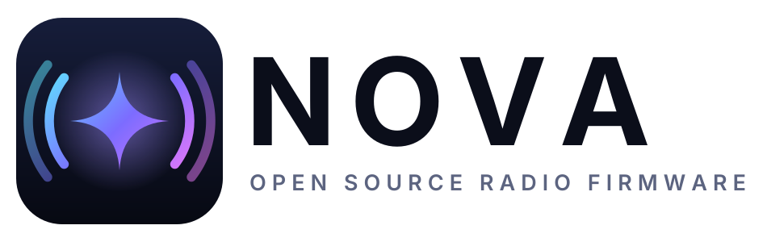
  </picture>
</p>

<p align="center">
  <b>A modern, complete and open source firmware for the ATS Mini pocket receiver.</b><br>
  ESP32-S3 + SI4732 · FM, AM, longwave, shortwave, SSB and CW · a web editor and a one-click installer.
</p>

<p align="center">
  <a href="https://github.com/isod89/nova-firmware/releases/latest"></a>
  <a href="LICENSE"></a>
  <a href="https://github.com/isod89/nova-firmware/actions/workflows/build.yml"></a>
  
</p>

<p align="center">
  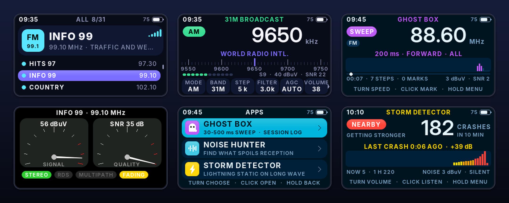
</p>

<p align="center">
  <a href="https://isod89.github.io/nova-firmware/NOVA-Installer.html"><b>Install NOVA from your browser</b></a> ·
  <a href="https://github.com/isod89/nova-firmware/releases/latest">Download</a> ·
  <a href="docs/tutorials/README.md">Tutorials</a> ·
  <a href="docs/user-guide.md">User guide</a> ·
  <a href="https://isod89.github.io/nova-firmware/NOVA-Editor.html">Web editor</a>
</p>

---

## Install in one minute

1. Open **[NOVA Installer](https://isod89.github.io/nova-firmware/NOVA-Installer.html)** in Chrome, Edge or Opera on a computer
   (or `NOVA-Installer.html` from the [latest release](https://github.com/isod89/nova-firmware/releases/latest), it works offline).
2. Plug the radio in with a USB data cable and click **Connect radio**.
3. **Back up** the original firmware (recommended), then **Install**.

The installer finds the right build for your radio by itself, can update NOVA without losing your stations,
and restores your backup whenever you want to go back. Command line scripts for Windows, macOS and Linux are
included in the release for those who prefer them. Details: [docs/installing.md](docs/installing.md).

## What's inside

**Listening**
- Station list with RDS names and text, favorites, filters (all, favorites, new, FM, AM, shortwave) and signal bars.
- Shortwave and AM station names from the [EiBi](http://www.eibispace.de/) world schedule, matched to the time of day,
  updated over Wi-Fi or from the editor.
- Free tuning in FM, AM, LSB, USB and CW: steps from 10 Hz, bandwidth, AGC/attenuation, keypad entry, band picker, seek,
  and a ±250 kHz spectrum scope.

**Finding stations**
- A full scanner for every band (FM 64-108 MHz, medium wave, longwave, shortwave broadcast bands and everything between),
  in three speeds, with time estimates, off-grid centring and a blocked list for noise.
- Standby search: the radio keeps looking for new stations while the screen is off.

**Apps**
- **Ghost Box**, a professional ITC sweep: 30-500 ms rates, six sweep orders, flutter, clusters around stations,
  noise control, RF trigger, catch, answer window, reaction-time correction, blind (Estes) mode, profiles and a session
  history. The editor adds recording, a spectrogram and printable reports.
- **Noise Hunter** finds what spoils your reception (chargers, LED lights, power supplies): walk around, the number goes up as you get closer.
- **Storm Detector** counts lightning crashes on longwave and tells you when a storm is approaching.

**Looks**
- 19 themes, an animated boot screen, smooth anti-aliased fonts and shapes, capital or normal letters.
- Six full-screen visualizers driven by the receiver's measurements: meters, LED bars, VU, trace, waterfall and a big display.

<p align="center"></p>

## Screens

| | | |
|:-:|:-:|:-:|
| 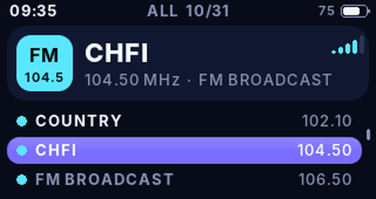 | 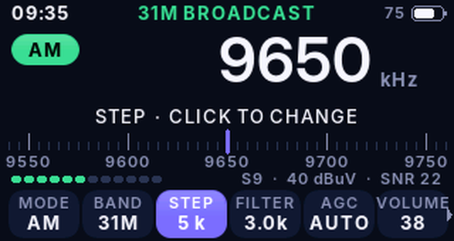 | 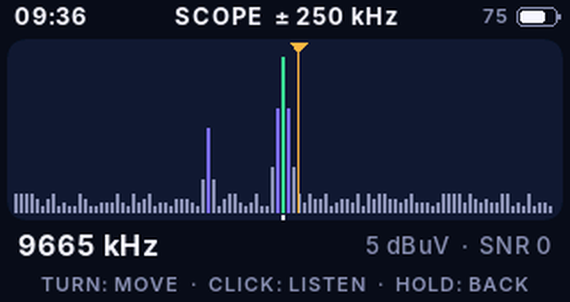 |
| Station list with RDS | Free tuning | Spectrum scope |
| 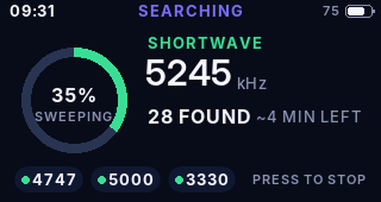 | 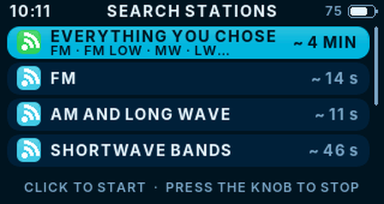 | 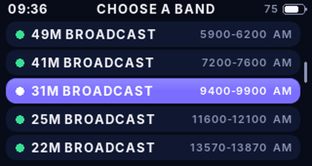 |
| Scanning every band | Choose what to search | Band picker |
| 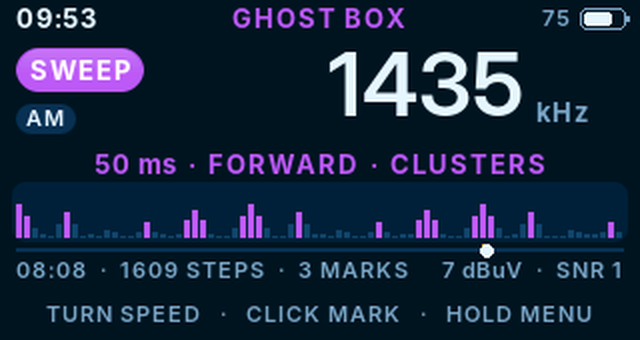 | 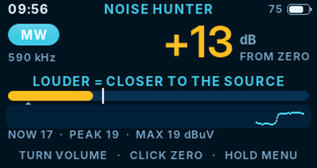 | 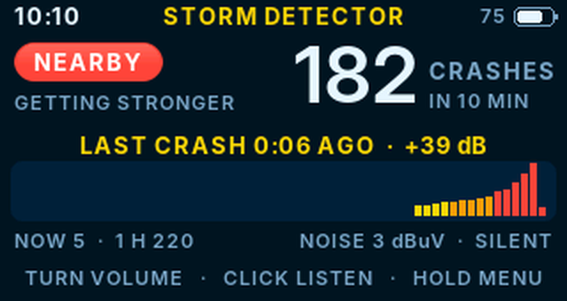 |
| Ghost Box | Noise Hunter | Storm Detector |

<details>
<summary><b>19 themes</b></summary>
<p align="center">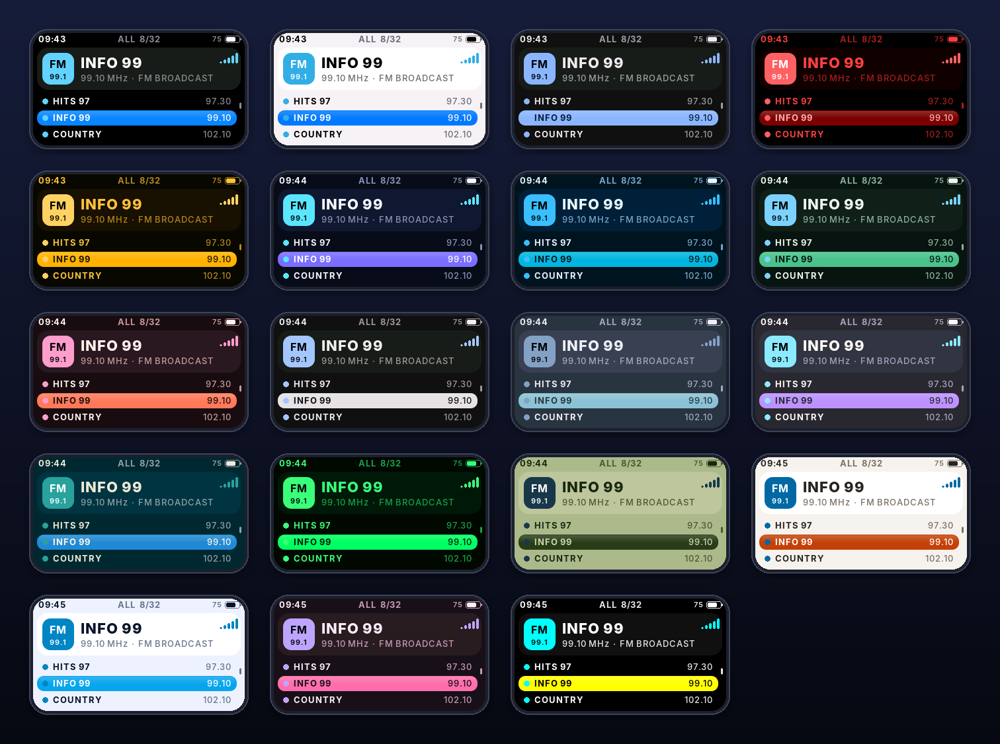</p>
</details>

<details>
<summary><b>Visualizers</b></summary>
<p align="center">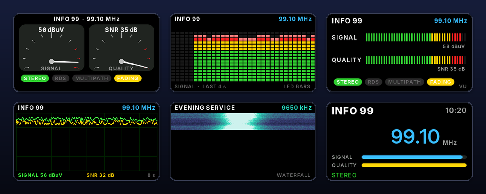</p>
</details>

## NOVA Editor

A complete control panel for the radio in one web page (Chrome, Edge or Opera, over USB, works offline):
stations and names, every setting, Wi-Fi station-name updates, backups, firmware updates, a live copy of the radio's
screen, and full studios for the three apps. Without a radio it opens a demo.

<p align="center">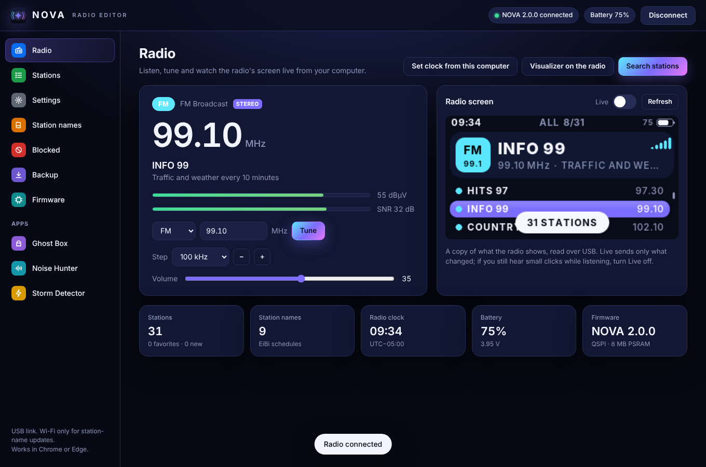</p>

| | |
|:-:|:-:|
| 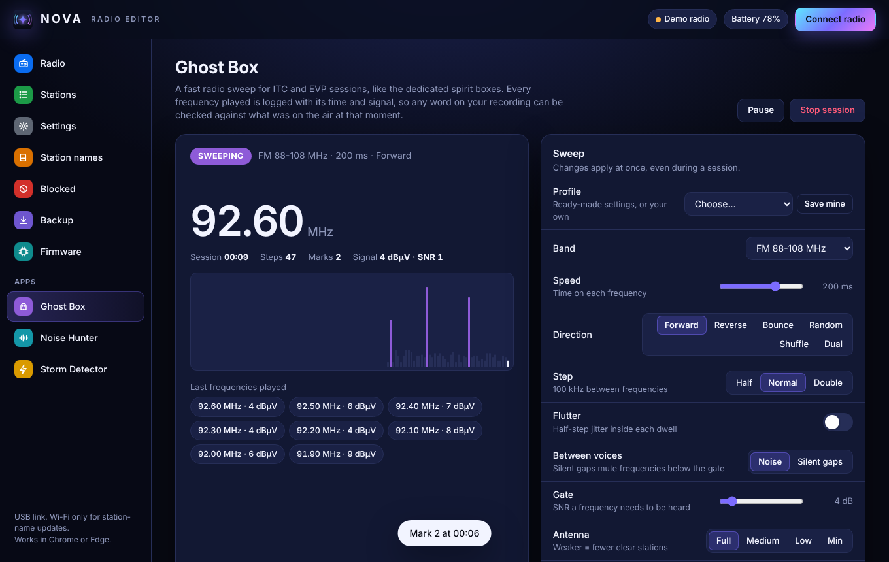 | 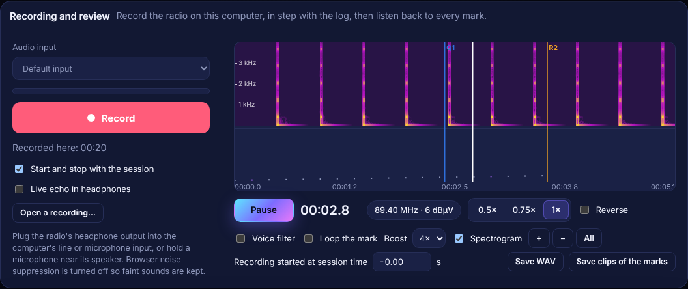 |
| Ghost Box live control | Recording review with spectrogram |
| 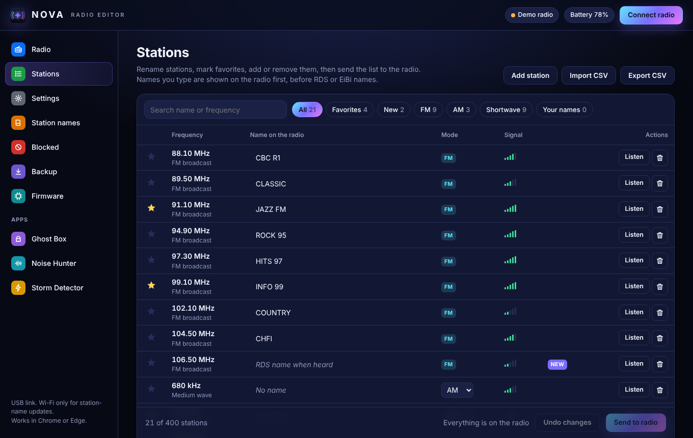 | 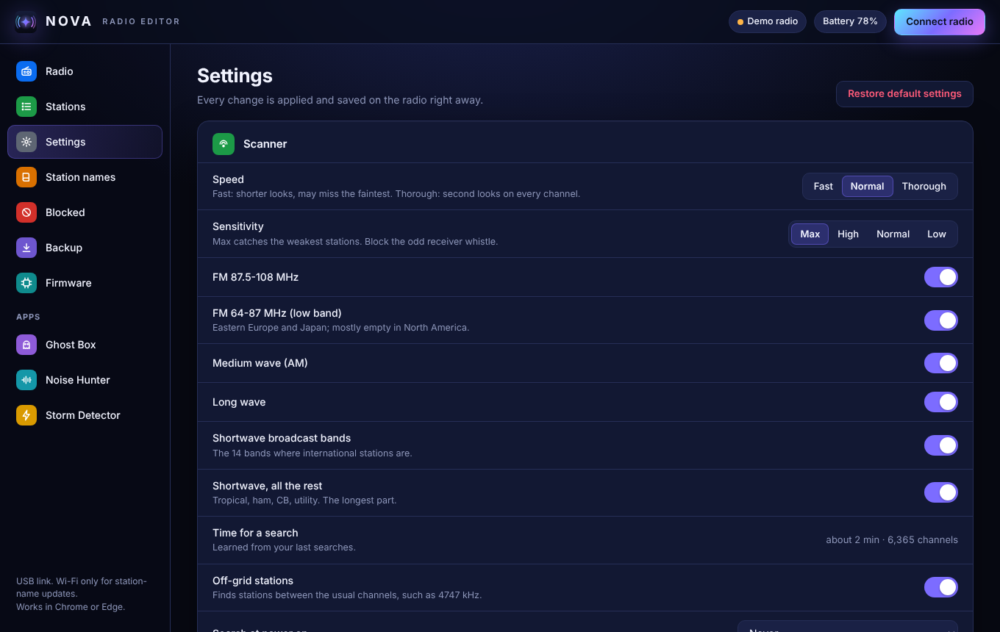 |
| Stations | Settings |
| 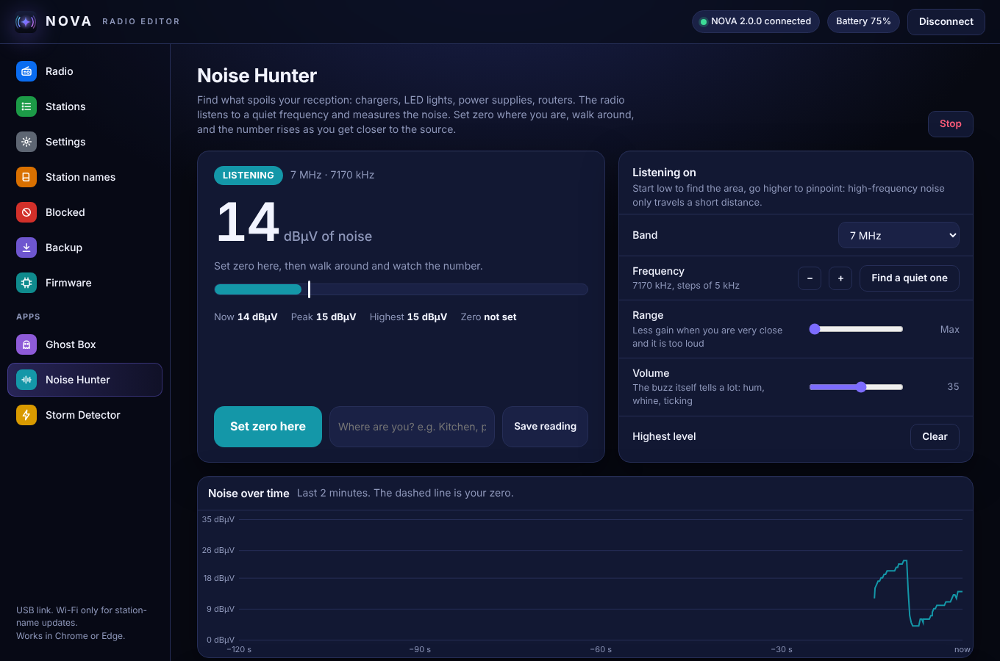 | 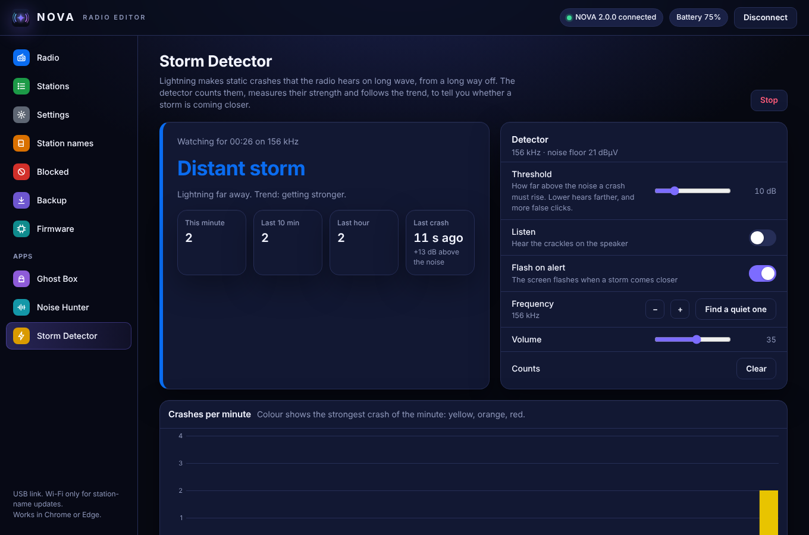 |
| Noise Hunter | Storm Detector |

## NOVA Installer

<p align="center">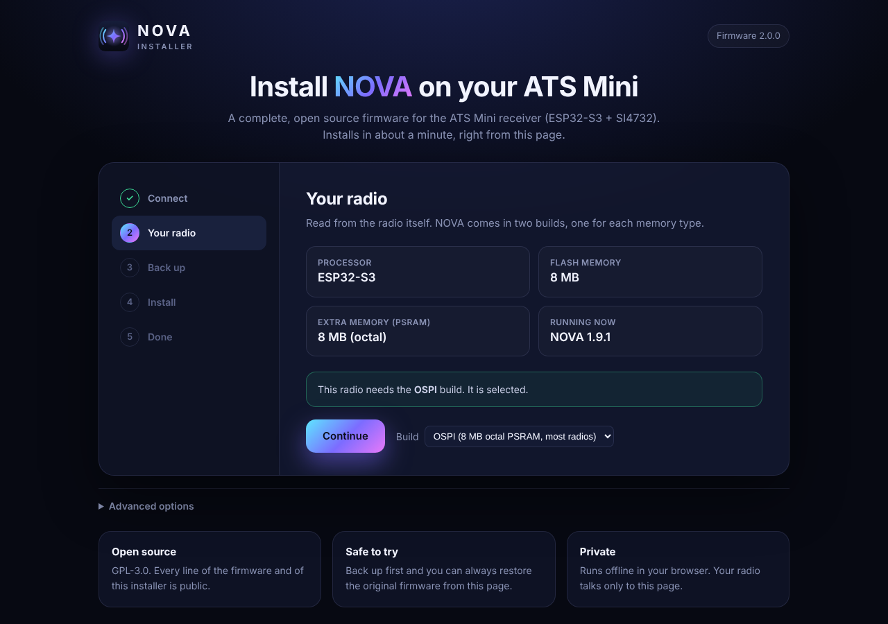</p>

Five steps, nothing to install: connect, the installer reads your radio and picks the right build, backs up the
original firmware, installs or updates NOVA (each part checked by MD5), done. Advanced options restore a backup or
erase the flash.

## Tutorials

| | | |
|:-:|:-:|:-:|
| [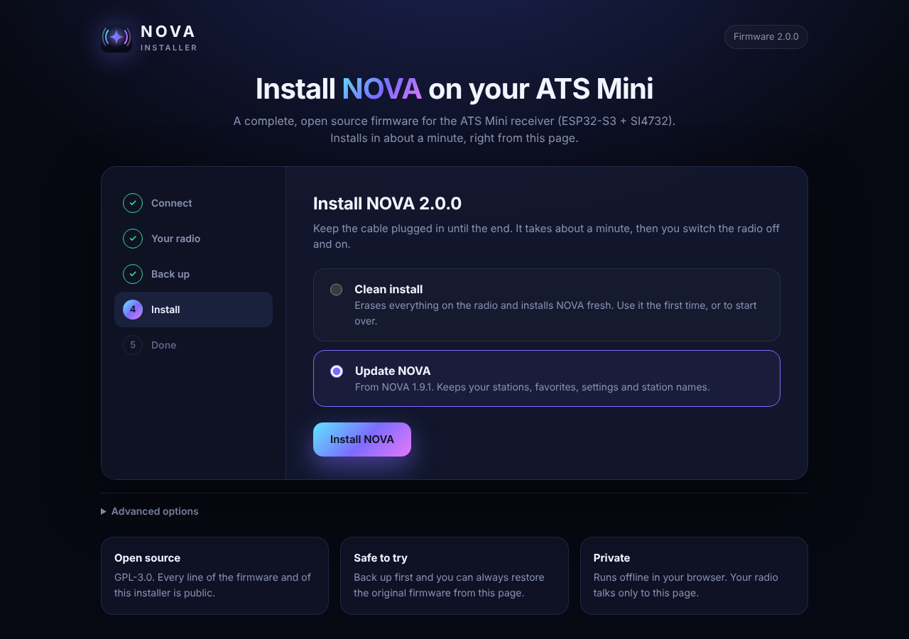](docs/tutorials/01-install.md)<br>**[1. Install NOVA](docs/tutorials/01-install.md)** | [](docs/tutorials/02-first-stations.md)<br>**[2. Your first stations](docs/tutorials/02-first-stations.md)** | [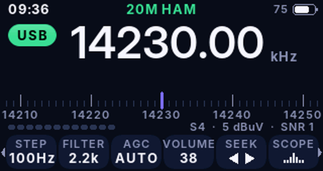](docs/tutorials/03-free-tuning.md)<br>**[3. Free tuning, shortwave, SSB](docs/tutorials/03-free-tuning.md)** |
| [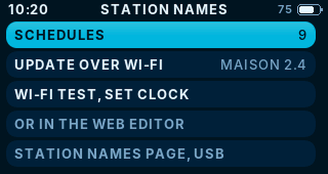](docs/tutorials/04-station-names.md)<br>**[4. Station names and the clock](docs/tutorials/04-station-names.md)** | [](docs/tutorials/05-web-editor.md)<br>**[5. The web editor](docs/tutorials/05-web-editor.md)** | [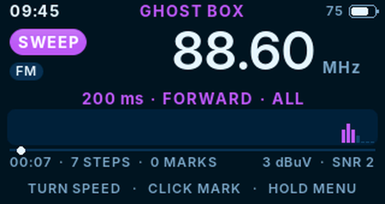](docs/tutorials/06-ghost-box-session.md)<br>**[6. A Ghost Box session](docs/tutorials/06-ghost-box-session.md)** |
| [](docs/tutorials/07-noise-hunter.md)<br>**[7. Noise Hunter](docs/tutorials/07-noise-hunter.md)** | [](docs/tutorials/08-storm-detector.md)<br>**[8. Storm Detector](docs/tutorials/08-storm-detector.md)** | [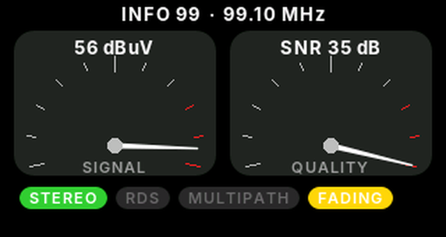](docs/tutorials/09-make-it-yours.md)<br>**[9. Themes, visualizers, power](docs/tutorials/09-make-it-yours.md)** |

**[10. Update, back up, go back](docs/tutorials/10-update-backup-restore.md)** · **[How NOVA works inside](docs/how-it-works.md)**

## Hardware

NOVA runs on the **ATS Mini** pocket receiver, versions V3 and V4 (ESP32-S3-WROOM with 8 MB of flash and the
Skyworks SI4732 receiver). Two builds exist because these radios ship with two kinds of PSRAM:

| Build | PSRAM | Radios |
|---|---|---|
| **OSPI** | 8 MB octal | most ATS Mini |
| **QSPI** | 2 or 4 MB quad | some early units |

The installer picks the right one. If a radio ever shows *Memory not found*, install the other build.

## Documentation

- [Tutorials](docs/tutorials/README.md): ten step-by-step guides
- [User guide](docs/user-guide.md): controls, screens, menus and settings
- [How NOVA works](docs/how-it-works.md): hardware, scanner, station names, storage
- [Installing, updating, going back](docs/installing.md)
- [Ghost Box](docs/ghost-box.md)
- [Web editor](docs/editor.md)
- [Building from source](docs/building.md)
- [USB protocol](docs/usb-protocol.md)
- [FAQ](docs/faq.md) · [Changelog](CHANGELOG.md) · [Contributing](CONTRIBUTING.md)

## Building

```sh
tools/build-firmware.sh          # both builds into build/ospi and build/qspi (arduino-cli)
python3 editor/build.py          # dist/NOVA-Editor.html
python3 installer/build.py       # dist/NOVA-Installer.html
tools/make-release.sh            # all of the above, packed as dist/NOVA-<version>.zip
```

A desktop simulator runs the real firmware code against a simulated radio and saves every screen as a picture:
see [tests/simulator](tests/simulator) and [docs/building.md](docs/building.md).

## Project layout

```
firmware/nova/     the firmware (Arduino sketch, ESP32-S3)
editor/            the web editor (one HTML file, built by editor/build.py)
installer/         the web installer (one HTML file with both firmware builds)
scripts/           command line installers for Windows, macOS and Linux
tests/simulator/   desktop simulator of the firmware
tools/             build, release, font and documentation tools
docs/              documentation and pictures
site/              the project website (GitHub Pages)
```

## Credits

NOVA is a new firmware, written on the shoulders of these projects:

- [ATS Mini](https://github.com/esp32-si4732/ats-mini) community firmware and hardware notes (display and button drivers, MIT)
- [PU2CLR SI4735](https://github.com/pu2clr/SI4735) library by Ricardo Lima Caratti (MIT)
- [LovyanGFX](https://github.com/lovyan03/LovyanGFX) graphics library (FreeBSD)
- Rotary encoder driver by Ben Buxton (GPL-3.0)
- [esptool-js](https://github.com/espressif/esptool-js) by Espressif (Apache-2.0)
- [Inter](https://github.com/rsms/inter) typeface by Rasmus Andersson (SIL OFL 1.1)
- [EiBi](http://www.eibispace.de/) shortwave schedules by Eike Bierwirth (downloaded by the user, not included)

Full notices: [THIRD_PARTY_LICENSES.md](THIRD_PARTY_LICENSES.md).

## License

NOVA is free software under the [GNU General Public License v3.0](LICENSE).
Copyright © 2025-2026 NOVA contributors.

*NOVA is a community project, not affiliated with the makers or sellers of the ATS Mini. Installing any firmware
is at your own risk; make a backup first, the installer makes it easy.*
