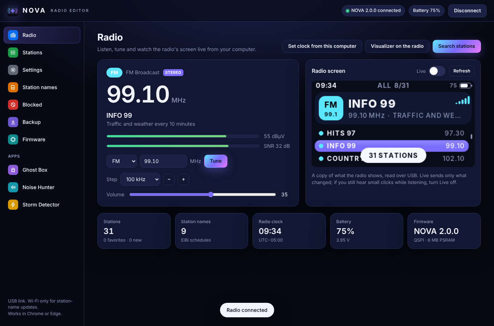

# NOVA Editor

`NOVA-Editor.html` is a complete control panel for the radio. It is a single file that works offline in
**Chrome, Edge or Opera** on a computer, over the USB cable (Web Serial). It never resets the radio when it connects.
Without a radio it opens a demo, so you can look around.

| Page | What you can do |
|---|---|
| Radio | live status, tune, start a search, a live copy of the radio's screen, open the visualizer |
| Stations | rename, favorite, delete, add stations; import and export CSV; filter and search |
| Settings | every setting of the radio, with explanations |
| Station names | import the EiBi schedule from a file, or save your Wi-Fi network and let the radio download it |
| Blocked | the frequencies the scanner ignores |
| Backup | save and restore settings and stations as a file |
| Firmware | install an update over USB |
| Ghost Box | the full session studio, see [ghost-box.md](ghost-box.md) |
| Noise Hunter | live level, history, spots |
| Storm Detector | alert level, counts per minute, event list |

The editor talks to the radio with a simple line protocol: [usb-protocol.md](usb-protocol.md).
