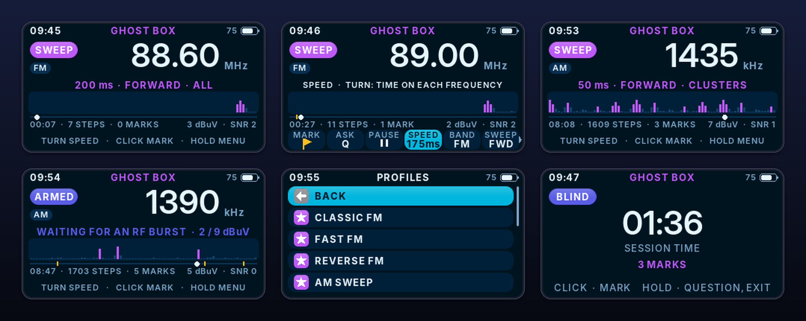
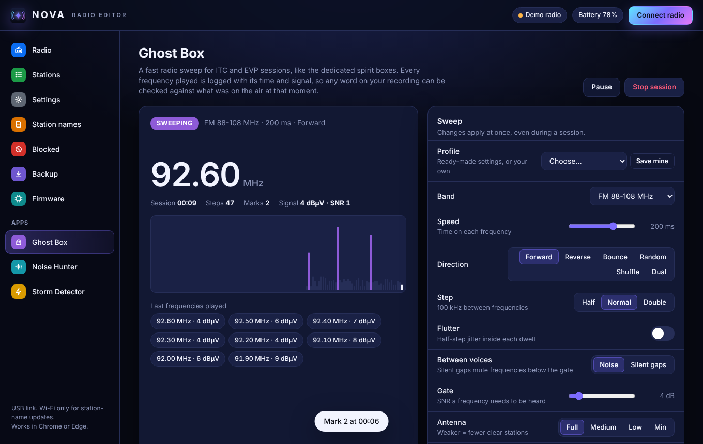

# Ghost Box

The Ghost Box sweeps the radio quickly across a band, the way dedicated "spirit boxes" (P-SB7, SB11, SB7 Pro) do, for
ITC and EVP sessions. NOVA logs every frequency it plays with the time and signal, so any word heard on a recording can
be checked against what was actually on the air at that moment. Whatever you believe about ghost boxes, the log makes
the session honest.

Apps > **Ghost Box**. **Click** marks a moment, **turn** changes the speed, **hold** opens the menu (controls,
profiles, question asked, blind mode, back to the radio).

## Sweep

| Control | Choices |
|---|---|
| Speed | 30 to 500 ms on each frequency |
| Band | FM 88-108, 76-108, 64-108 MHz, AM, LW, the 49/41/31/25/19 m bands, all shortwave 2.3-26 MHz |
| Sweep | Forward, Reverse, Bounce, Random, **Shuffle** (every frequency once per round, new order each round), **Dual** (a forward and a reverse sweep taking turns) |
| Play | All, Noise only (skips stations), Stations only, Marked (replays the frequencies where you marked something), **Clusters** (only around stations, like the SB7 Pro "hot spots") |
| Width | clusters: steps on each side of a station |
| Step | normal, double or half step |
| Jitter | a half-step flutter inside each dwell (like the SB7's 50 kHz flutter) |
| Chaos | an irregular rhythm (±25 or ±50 %) instead of a metronome |
| Noise | the radio chip's soft mute: raw static, normal, quiet |
| Gaps | noise between stations, or silence below the gate |
| Gate | SNR a frequency needs to be heard |
| Aerial | antenna attenuation: less antenna, fewer clear stations |
| From / To | sweep only part of the band |

## Responses

| Control | What it does |
|---|---|
| Ask | marks a **question** (Q). Normal marks are **responses** (R); each shows how long after the question it came |
| React | reaction-time correction (0 to 1 s): a mark records the frequency that was playing that long before your click |
| Hold | after a response mark, go back to the heard frequency and stay 1 to 10 s, or stop there |
| Catch | when a frequency has a real signal, stay on it 0.5 to 5 s so a whole word can be heard |
| Above | the SNR that counts as a signal for Catch |
| Wait | answer window after each question: a countdown, the screen flashes at the end |

## RF trigger

**Arm** puts the box in trigger mode (like the SB7 Pro): the radio stays muted on the quietest frequency it has seen
and opens the sweep for **Open** seconds when an RF burst arrives (**Sens** dB above normal). Each burst is marked **T**.
What triggers it depends on the place: static discharges, sparks, appliances switching, phones. It detects radio
bursts received by the antenna; it is not an EMF meter.

## Sessions

- **Timer**: a session length (5 to 60 min); the sweep pauses and the screen flashes at the end.
- **Blind** (Estes method): the screen hides frequency and signal; only time and marks are shown.
- **Profiles**: nine ready-made settings (Classic FM, Fast FM, Reverse FM, AM sweep, Estes session, Hot-spot clusters,
  Noise only, Slow AM irregular, Shortwave chaos) and three of your own.
- **History**: the radio keeps the settings and marks of its last 20 sessions.

## In the web editor

- Live view, all controls, profiles, big **Heard something** (Space) and **Question asked** (Q) buttons.
- **Recording** synchronised with the log, from any audio input (the radio's headphone output into the computer's line
  input works best). The browser's noise suppression is turned off so faint sounds are kept.
- **Review**: waveform or **spectrogram** (0-4 kHz, where voices are), zoom, the frequencies played under the sound,
  every mark; 0.5× and 0.75× speed, reverse, voice filter, boost, loop around a mark.
- **Source check** for every response: a station in your list, a strong or weak carrier, or noise only. A response on a
  known station is most likely the broadcast itself.
- **Exports**: WAV, a ZIP with a clip per mark, CSV of the marks and of the whole log, a session file to reopen later,
  and a printable report.

## Good practice

1. Record, and start the recording before the sweep.
2. Mark the moment you hear something, before you interpret it; write the words afterwards, word for word.
3. Check each response with the source check: a clear word on a strong, steady frequency is usually a broadcast.
4. Note your settings; speed, direction and band change what you hear. The report includes them.
