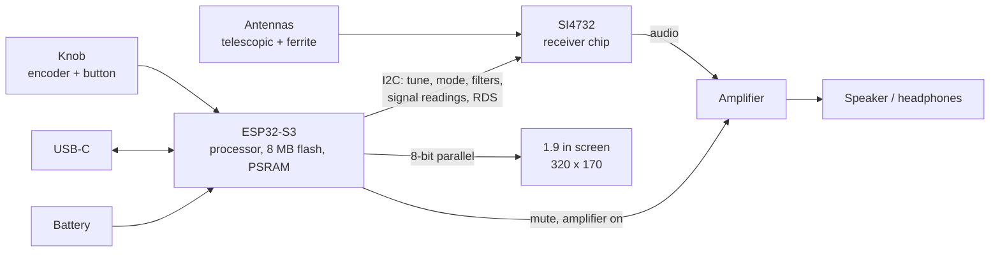

# How NOVA works

A tour of what happens inside the radio, for the curious and for contributors.

## The hardware

- The **SI4732** does all the radio work: it tunes, demodulates FM, AM, SSB and CW, decodes RDS, and sends the sound
  straight to the amplifier.
- The **ESP32-S3** runs NOVA. It tells the SI4732 what to do and reads back the signal strength (dBµV), the
  signal-to-noise ratio, stereo, multipath and RDS. **The sound never passes through the processor**: that is why NOVA
  cannot record, play internet radio or draw a real audio spectrum, and why the visualizers show the receiver's
  measurements instead.
- The screen is driven by LovyanGFX. Every frame is drawn in a full-screen image in memory, then sent in one go: no
  flicker, and the anti-aliased Inter fonts stay smooth.

## Starting up

1. The processor starts NOVA and immediately launches the **boot animation** on its second core.
2. Meanwhile, the other core loads the settings, the station list and the station names, and wakes the SI4732.
3. When both are done, the animation ends and the radio plays the last station. A click skips the animation.

## What is stored where

| Where | What |
|---|---|
| Flash `app0` / `app1` | the NOVA program (two slots, so an update can be written next to the running one) |
| `settings` (NVS) | your settings, the station list with names and favorites, the blocked frequencies, the Wi-Fi network, the Ghost Box, Noise Hunter and Storm Detector settings, the learned search times |
| `littlefs` | the EiBi schedule (`/eibi.bin`) and the last 20 Ghost Box sessions (`/gb/`) |
| PSRAM | working memory: the EiBi schedule for instant lookups, the scanner's buffers, the boot animation, large screen images |

## The scanner

A search goes band by band (FM, FM low, medium wave, long wave, the 14 shortwave broadcast bands ordered for the time
of day, then the rest of shortwave without gaps). For each part:

1. **Sweep** every channel. On shortwave the receiver uses its 6 kHz filter, so a station between two 5 kHz steps is
   still caught.
2. Measure the **noise floor** of that part (the median level) and set the detection threshold above it: quiet bands
   reveal weak stations, noisy ones do not flood the list.
3. **Second chance**: channels just under the threshold are measured again, longer (shortwave fades).
4. Keep only **peaks**: a weaker signal next to a strong station is its splatter.
5. **Confirm** each peak with the 3 kHz filter, centre it to the exact kHz (stations off the usual grid), then average
   the best of five readings.
6. **Save** the part at once, so stopping keeps everything found so far.

FM waits for the RDS name on each station. The time each part really takes is learned, so the estimates in the
*Search stations* menu get better with use.

## Station names

- **FM**: the RDS name the station sends, kept with the station.
- **AM and shortwave**: the EiBi schedule, sorted by frequency in PSRAM. For a frequency the radio looks up who
  broadcasts there at the current UTC time (hence the clock and time zone settings), in a fraction of a millisecond.
- **Your own names** (typed in the editor) always come first.

The schedule arrives from the editor over USB, or the radio downloads it over **Wi-Fi**: it joins your network with
the sound off, downloads `eibi.txt`, sets the clock by NTP, and switches Wi-Fi off. Wi-Fi is never on while you listen,
because the ESP32's own radio can add noise to shortwave.

## The apps

- **Ghost Box**: a timer steps the SI4732 through a list of frequencies (forward, reverse, bounce, random, shuffle or
  dual). Each step is logged with time, frequency, signal and SNR; marks point into that log. *Catch*, *Clusters* and
  the RF trigger use the signal readings to decide what to play.
- **Noise Hunter**: fixed receiver gain (automatic gain would hide the change) on a quiet frequency; the level in dBµV
  is compared with your zero.
- **Storm Detector**: fixed gain on the quietest long-wave frequency; short bursts above the noise floor are counted
  as lightning crashes, with their strength and the trend.

## The USB link

The radio appears as a USB serial port. The editor sends text commands (`STATUS`, `TUNE`, `ST`, `CFG`, `GB`...) and reads
the answers; see [usb-protocol.md](usb-protocol.md). Opening the port never resets the radio. The installer uses the
ESP32-S3's built-in USB bootloader instead (through esptool-js), which is why it can install on any radio, with or
without NOVA.

## The code

| File | Role |
|---|---|
| `nova.ino` | start-up and the main loop |
| `Radio.cpp` | everything that talks to the SI4732 |
| `Scanner.cpp`, `Stations.cpp`, `Schedule.cpp` | searching, the station list, EiBi names |
| `Ui*.cpp`, `Splash.cpp` | the screens, menus, themes, visualizers and boot animation |
| `Ghost.cpp`, `Tools.cpp` | the Ghost Box engine, Noise Hunter and Storm Detector |
| `Usb.cpp`, `Wifi.cpp` | the editor protocol, the Wi-Fi jobs |
| `System.cpp` | settings, storage, battery, power |

The [simulator](building.md#simulator) compiles the same files for a computer, against a simulated SI4732, and saves
every screen as a picture. The pictures in this documentation come from it.
