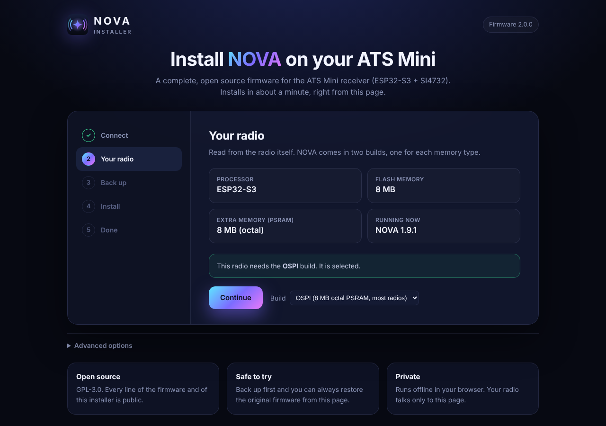

# Installing, updating and going back

## NOVA Installer (recommended)

Open [NOVA Installer](https://isod89.github.io/nova-firmware/NOVA-Installer.html) or `NOVA-Installer.html` from the
release (it works offline) in **Chrome, Edge or Opera** on Windows, macOS, Linux or ChromeOS.

1. **Connect.** Switch the radio on, plug it in with a USB *data* cable, click **Connect radio** and pick
   *USB JTAG/serial debug unit* (or *ESP32-S3*).
2. **Your radio.** The installer reads the processor, flash and PSRAM, and whether NOVA is already installed, then
   selects the right build (OSPI or QSPI).
3. **Back up.** Saves the whole flash (8 MB) as `ats-mini-backup-<date>.bin` in your Downloads folder. Do it the first
   time: it is your way back to the original firmware.
4. **Install.** *Clean install* erases everything and installs NOVA fresh. *Update NOVA* (when NOVA is already there)
   keeps your stations, favorites, settings and station names. Every part written is checked.
5. **Restart the radio.** Switch it off and on again. After an install over USB the radio does not always restart by
   itself and can stay on a dark screen: this is normal. If the screen stays dark, unplug the USB cable and switch it
   on again. The same applies after restoring a backup.

<p align="center"></p>

### Going back to the original firmware

Installer > **Advanced options** > **Restore a backup**, and choose the `.bin` file you saved.

### The radio is not found

- Use a USB cable that carries data (many charging cables do not).
- Close the NOVA Editor, the Arduino IDE, serial monitors and anything else that may hold the port.
- **Install mode:** switch the radio off, hold the BOOT button, plug the cable in (or switch on), release BOOT, and
  click Connect again. The screen stays dark in this mode, that is normal.
- On Linux, add yourself to the `dialout` group (or `uucp` on Arch) and log in again.

### "Memory not found" after installing

The radio has the other kind of PSRAM. Run the installer again and choose the other build in step 2.

## Command line

The release contains `scripts/nova-install.bat` (Windows) and `scripts/nova-install.sh` (macOS, Linux). Both use
Espressif's official [esptool](https://github.com/espressif/esptool) and offer the same choices: back up, clean
install, update, restore.

```sh
scripts/nova-install.sh                 # finds the port by itself
scripts/nova-install.sh /dev/ttyACM0    # or give it
```

Manual install with esptool:

```sh
esptool --chip esp32s3 write-flash 0x0 firmware/ospi/nova.ino.merged.bin      # clean install
esptool --chip esp32s3 write-flash 0x10000 firmware/ospi/nova.ino.bin         # update, keeps your data
```

## Updating from the web editor

Editor > **Firmware**: drop `nova.ino.bin` (keeps your data) or `nova.ino.merged.bin` (clean install).
