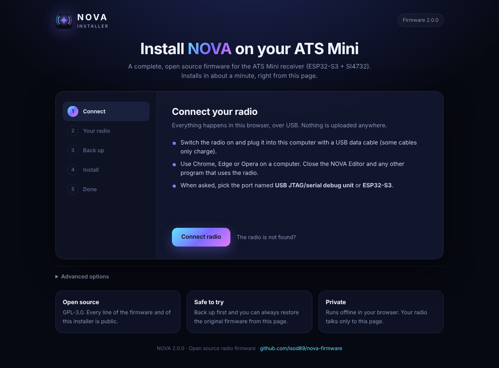
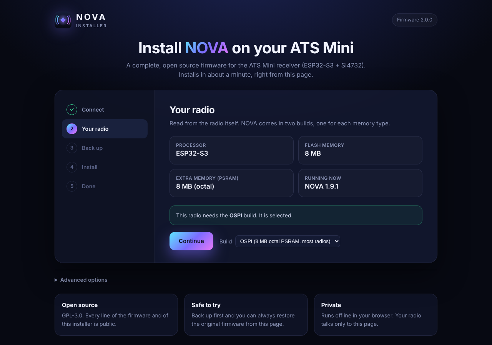
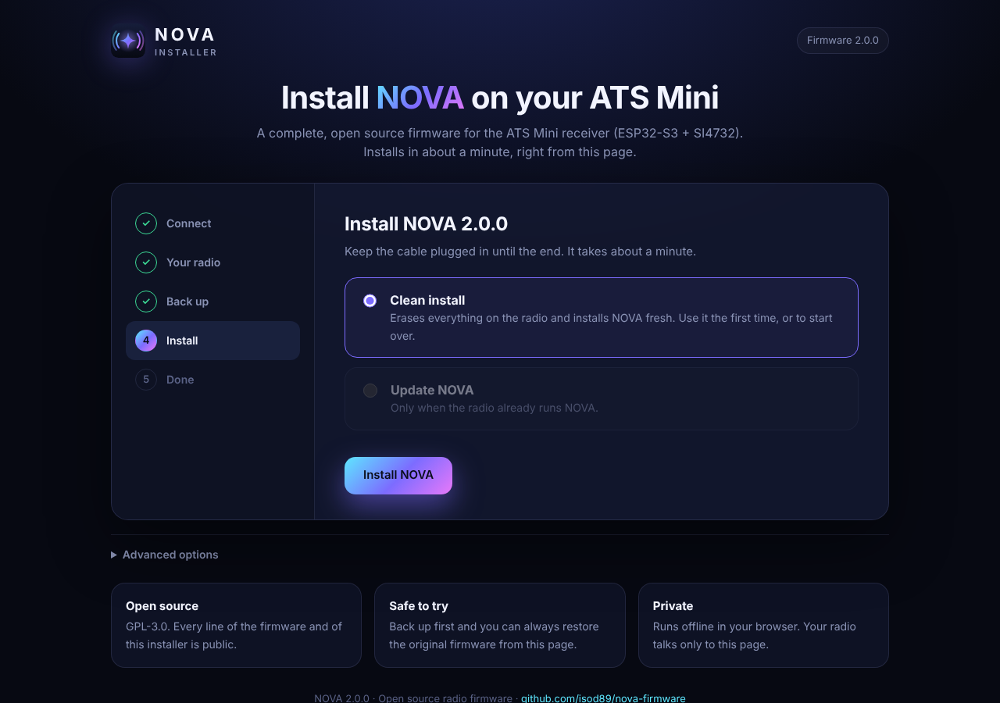
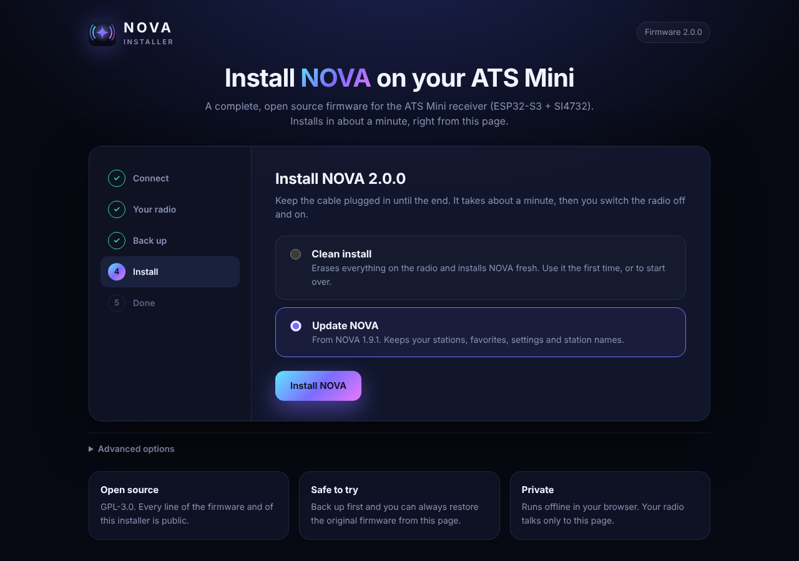
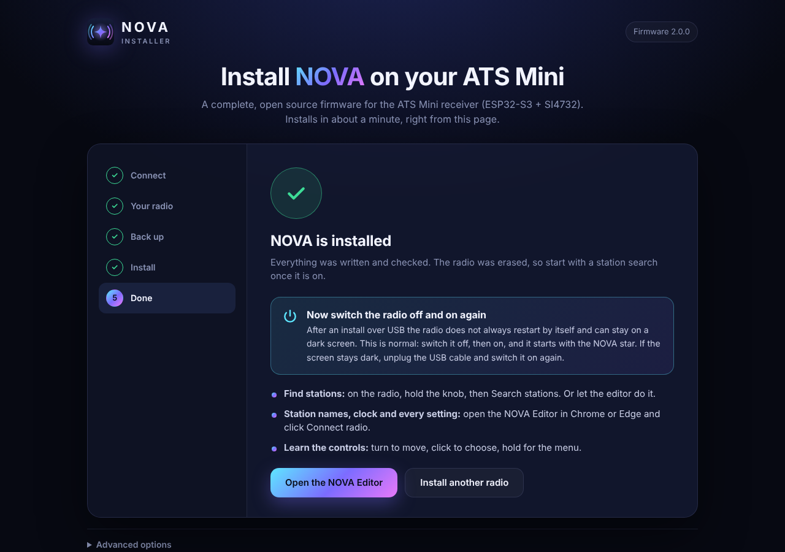

# 1. Install NOVA

**You need:** the ATS Mini, a USB-C **data** cable (some cables only charge), a computer with **Chrome, Edge or Opera**.
**Time:** 5 minutes, including the backup.

## Open the installer

Open **[NOVA Installer](https://isod89.github.io/nova-firmware/NOVA-Installer.html)**, or `NOVA-Installer.html` from the
release zip (it works offline, both firmware builds are inside the page).

1. Switch the radio on and plug it into the computer.
2. Click **Connect radio**. The browser lists the serial ports: choose **USB JTAG/serial debug unit** (or the one marked
   ESP32-S3) and click *Connect*.

> **Nothing in the list?** Try another cable or USB port, and close any other program that uses the radio (Arduino IDE,
> a serial monitor, the NOVA Editor). Still nothing: switch the radio off, hold the **BOOT** button (on the board, or
> the knob on some models), plug the cable in, release it and click **Connect radio** again. The screen stays dark in
> this mode, that is normal. The installer's *The radio is not found?* link explains the same.

## Check your radio

The installer reads the processor, the flash memory and the PSRAM from the radio itself, and picks the right build:
**OSPI** for 8 MB octal PSRAM (most radios) or **QSPI** for 2-4 MB quad PSRAM. You can change it in the *Build* list,
but the choice made for you is the right one. Click **Continue**.

## Back up the original firmware

Click **Back up now**. The installer copies the whole 8 MB flash of the radio (firmware, settings, everything) into a
`.bin` file that your browser downloads. It takes about two minutes. **Keep this file**: it is the only way back to
exactly what your radio had. (If NOVA is already installed, this step is skipped.)

## Install

- **Clean install**: erases the radio and installs NOVA. Use it the first time, or to start fresh.
- **Update NOVA**: only shown when NOVA is already on the radio. Keeps your stations, favorites, settings and station names.

Click **Install NOVA** and keep the cable plugged in until the end (about a minute). Every part written is checked with
an MD5 checksum.

## Done

**Now switch the radio off and on again.** After an install over USB the radio does not always restart by itself and
can stay on a dark screen: this is normal. Switch it off, then on, and it starts with the NOVA boot animation. If the
screen stays dark, unplug the USB cable and switch it on again.

Next: [find your first stations](02-first-stations.md).

**If the radio shows "Memory not found":** it needs the other build. Run the installer again and choose it in step 2.
