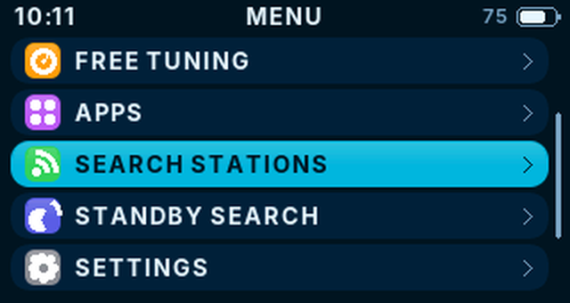
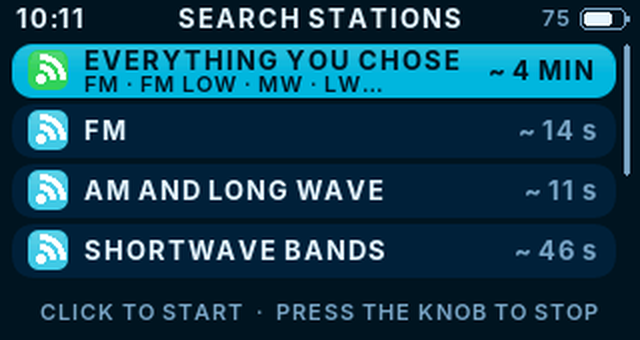
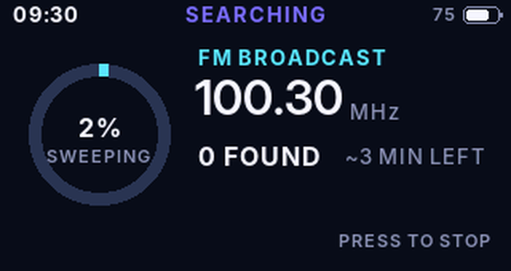
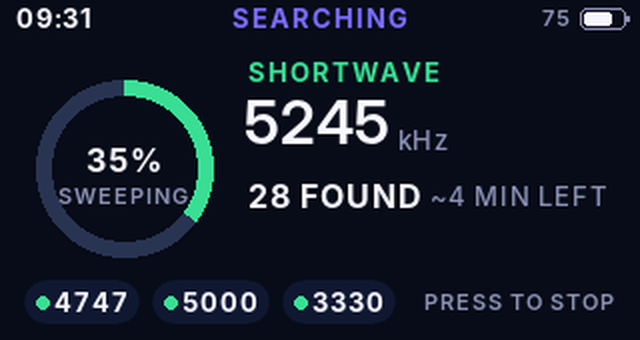
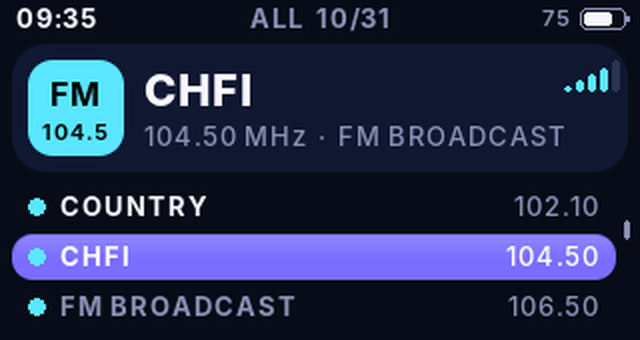
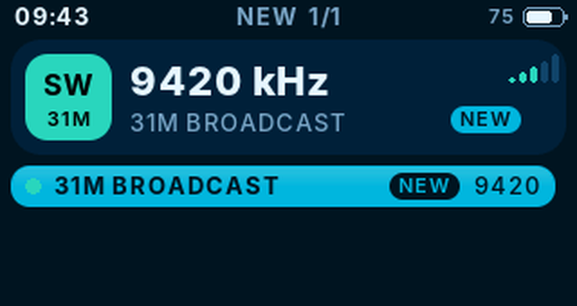
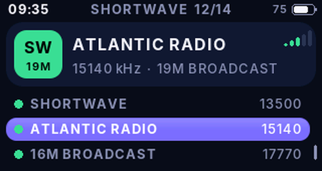
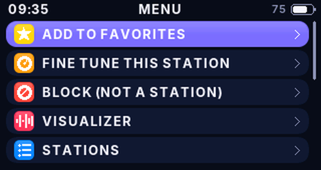
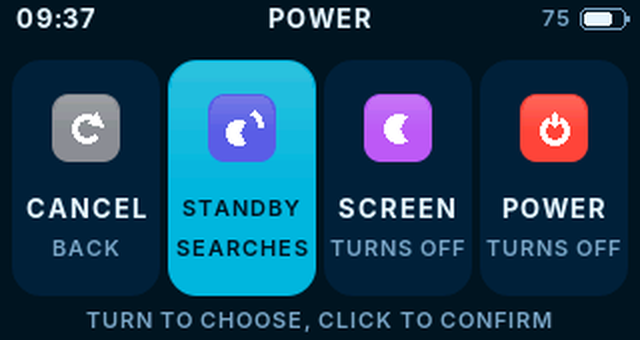

# 2. Your first stations

After a clean install the station list is empty. NOVA never searches by itself unless you ask it to
(Settings > Scanner > *Search at power on*).

## Start a search

 

1. **Hold** the knob: the menu opens.
2. **Turn** to **Search stations** and **click**.
3. Each line shows what it covers and how long it takes. **Everything you chose** searches every band switched on in
   Settings > Scanner; **FM** alone takes about 15 seconds.
4. The **Speed** line changes how carefully NOVA listens: *Fast* (strong stations), *Normal*, *Thorough* (weak
   shortwave stations, longer).
5. Click a line to start.

 

The ring shows the progress, with the frequency, the number found, the time left and the last stations found.
**Click** to stop at any time: everything found so far is kept.

> **Good to know.** On shortwave NOVA measures the noise of each band and adapts its threshold, centres every station
> to the exact kHz (stations a few kHz off the usual grid are found too) and listens twice to channels that fade.
> Shortwave reception changes with the time of day: search again in the evening to find other stations.

## Browse the list

 

- **Turn** to go to the next or previous station. The big card shows the name (RDS on FM, the EiBi schedule on
  shortwave and AM), the frequency, the band and the live signal bars. FM stations also show their RDS text.
- **Click** for the volume, then turn. It closes by itself.
- **Turn while pressing** to change the filter shown at the top: **All, Favorites, New, FM, AM, Shortwave**.

 

## Favorites and blocked frequencies

Hold the knob on a station:

- **Add to Favorites**: the star filter shows only your favorites.
- **Fine tune this station**: opens free tuning on it (next tutorial).
- **Block (not a station)**: for a frequency that is only noise or a computer whistle. It disappears and future
  searches skip it. Settings > Scanner > *Unblock all* brings them back.

## Let the radio search while you sleep

**Hold 2 s** > **Standby**, or menu > **Standby search**: the screen goes off and the radio searches every so often.
New stations get a **NEW** tag and appear in the *New* filter.

Next: [free tuning, shortwave and SSB](03-free-tuning.md).
