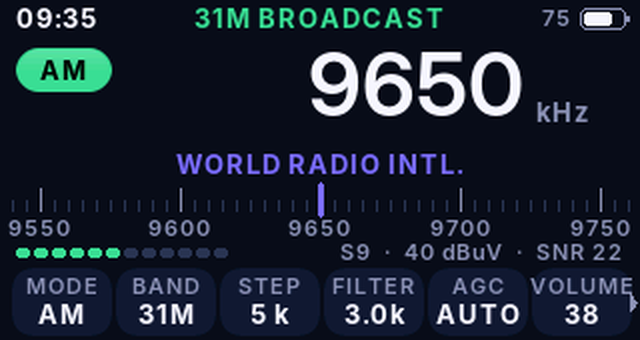
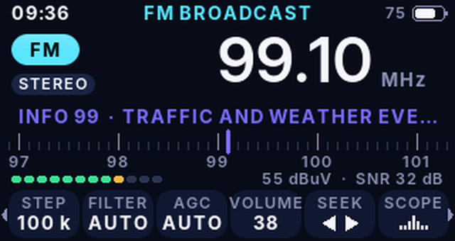
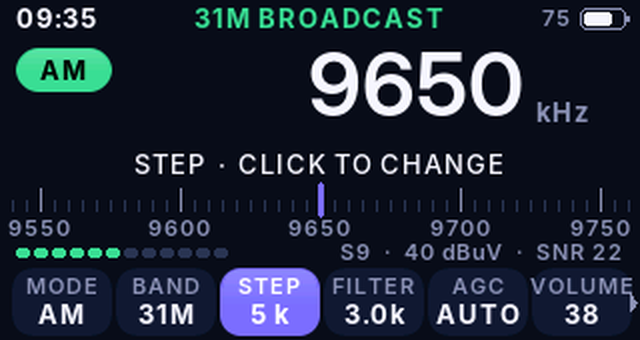
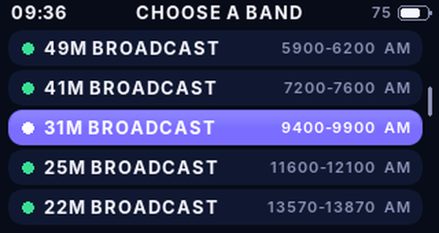
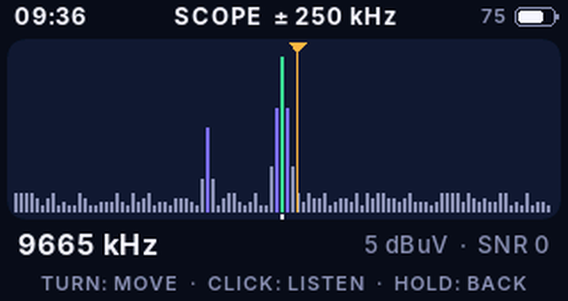
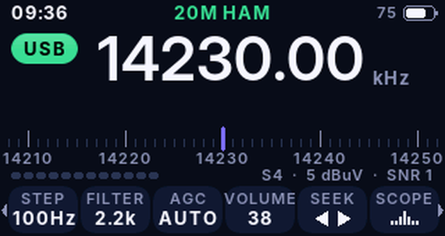
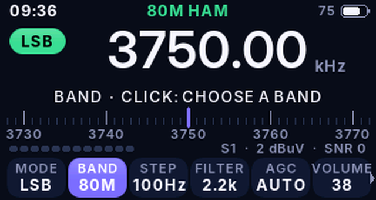

# 3. Free tuning, shortwave and SSB

Free tuning is the "real receiver" side of NOVA: any frequency from 150 kHz to 30 MHz and 64 to 108 MHz, in AM, FM,
LSB, USB and CW. Open it with menu > **Free tuning**, or **Fine tune this station** from the station list.

 

## Tune

- **Turn** to tune by the current step. Turning fast speeds up.
- **Turn while pressing** for big jumps: 1 MHz in FM, 100 kHz in AM, 10 kHz in SSB.
- The scale shows where you are; the S-meter, signal (dBµV) and SNR are under it.

## The control strip

**Click** to open the strip at the bottom. **Turn** to pick a control (the line above tells you what it does), **click**
to change it, turn, click again. **Hold** closes the strip; it also closes by itself after 10 seconds.

 

| Control | Use it to |
|---|---|
| **Mode** | AM, FM, LSB, USB, CW |
| **Band** | jump to a broadcast, amateur or utility band (the list shows each range) |
| **Step** | the tuning step: down to 10 Hz in SSB |
| **Filter** | the receiver bandwidth: narrower against a strong neighbour, wider for music |
| **AGC** | automatic gain, or a fixed attenuation for very strong signals |
| **Volume** | the volume |
| **Seek** | jump to the next station up or down |
| **Scope** | see ±250 kHz of spectrum around you |
| **Keypad** | type a frequency |
| **Save** | add this frequency to your stations, as a favorite |

## Listen to a shortwave broadcast

1. **Band** > *31m Broadcast* (9400-9900 kHz) in the evening, or *19m* (15100-15800 kHz) during the day.
2. Open the **Scope**: each bar is a signal. **Turn** to move the cursor onto a tall bar, **click** to listen there.
   **Hold** to go back.
3. Set **Filter** to 4 or 6 kHz for broadcasts, narrower if a neighbour splashes.
4. **Save** it if you want it in your list.

## Listen to radio amateurs (SSB)

1. **Band** > *40m Ham* or *80m Ham*. NOVA switches to **LSB** below 10 MHz and **USB** above.
2. Set the **Step** to 100 Hz, or 10 Hz for the final touch.
3. Tune slowly until the voices sound natural (too high: "Donald Duck", too low: muffled).
4. A **Filter** of 2.2-2.4 kHz is right for voice; 0.5 kHz for CW (morse).

If SSB voices always sound slightly off, Settings > Reception > *SSB calibration* corrects your radio's crystal.

 

## Type a frequency

**Keypad**: turn to change the digit, click for the next one. After the last digit the radio tunes there. **Hold** cancels.

Next: [station names and the clock](04-station-names.md).
