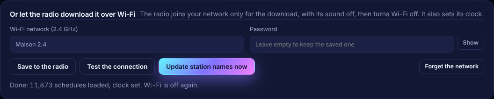
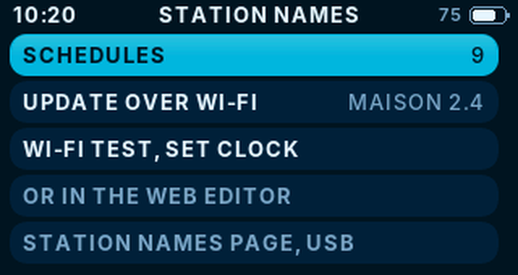
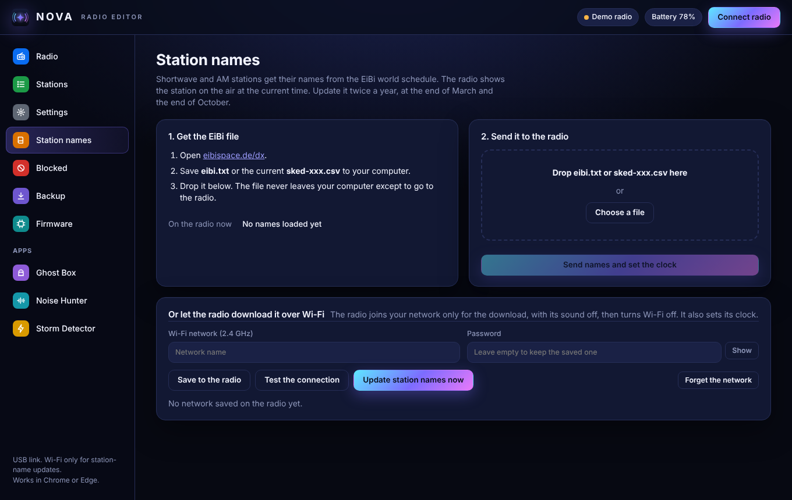

# 4. Station names and the clock

FM stations send their own name (RDS). AM and shortwave stations do not, so NOVA uses the **EiBi** world schedule:
a list of 10,000+ broadcasts with their frequency and hours. The radio shows who is on the air **at the current time**,
so two things are needed: the schedule, and the right time.

Update the schedule twice a year, at the end of March and the end of October, when the broadcasters change seasons.

## Option A: over Wi-Fi (the easiest)

The radio uses Wi-Fi only for this, only when you ask, and switches it off again right after.

**1. Save your network, once, from the editor.** Connect the radio by USB, open the NOVA Editor, go to
**Station names**. In *Or let the radio download it over Wi-Fi*, type your network name and password and click
**Save to the radio**. The password goes over the USB cable only and stays in the radio.

Only 2.4 GHz networks work (the ESP32-S3 has no 5 GHz radio). **Test the connection** checks it and sets the clock.

**2. Update.** Click **Update station names now** in the editor, or, on the radio without a computer:
Settings > **Station names** > **Update over Wi-Fi**. The radio joins the network with its sound off, downloads the
schedule from eibispace.de, sets the clock from the internet, and switches Wi-Fi off. It takes a minute or two.

*Wi-Fi test, set clock* on the same page only sets the clock.

## Option B: from a file, over USB

1. Download `eibi.txt` (or the current `sked-xxx.csv`) from [eibispace.de/dx](http://www.eibispace.de/dx/).
2. In the editor's **Station names** page, drop the file in the box (or *Choose a file*).
3. Click **Send names and set the clock**. The file never leaves your computer except to go to the radio.

## The clock

The clock and the time zone are in Settings > **Clock**. Besides Wi-Fi and the editor (*Set clock from this computer*
on the Radio page), the radio can take the time from FM: turn on **Set from FM (RDS)** and the clock is set whenever
an FM station sends the time. Check the **time zone** there too: EiBi hours are in UTC and NOVA converts them.

Next: [the web editor](05-web-editor.md).
