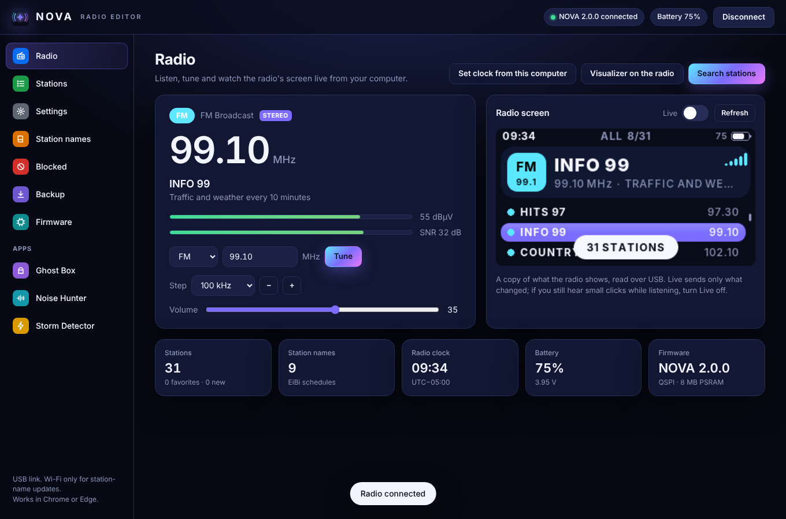
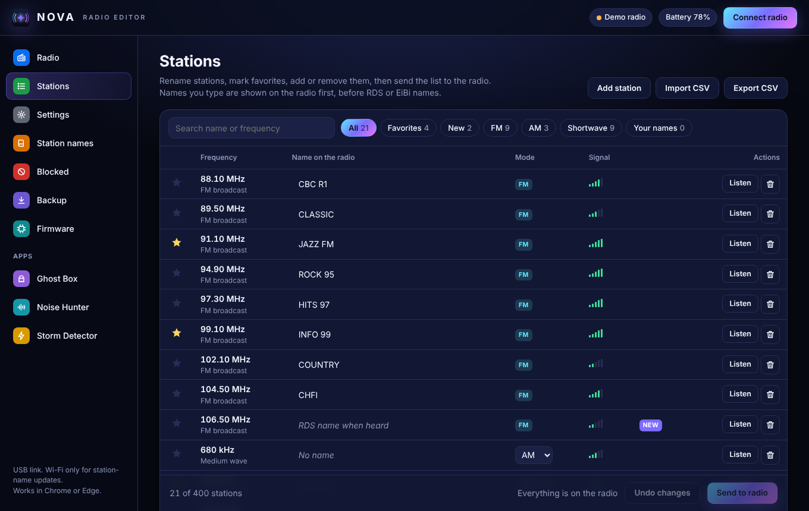
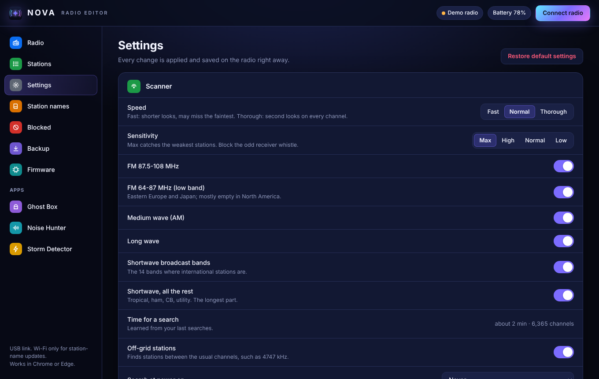
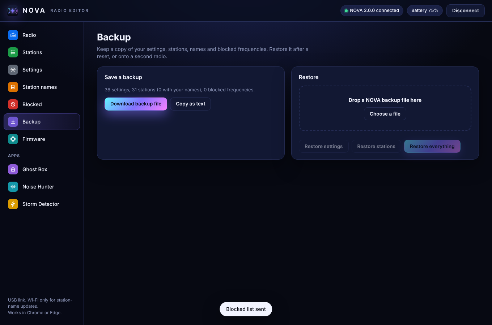
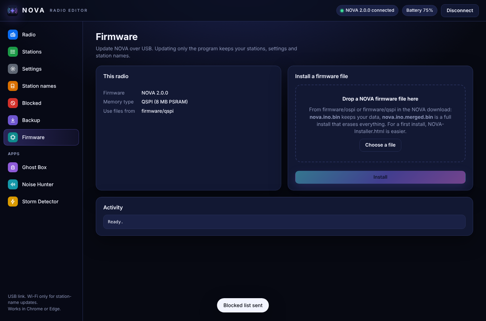

# 5. The web editor

The NOVA Editor is a complete control panel for the radio, in a single web page that works offline. Open
**[NOVA Editor](https://isod89.github.io/nova-firmware/NOVA-Editor.html)** (or `NOVA-Editor.html` from the release) in
**Chrome, Edge or Opera** on a computer.

Without a radio it opens a **demo**, so you can look around. Plug the radio in and click **Connect radio**, then pick the
port (*USB JTAG/serial debug unit*). Connecting never restarts the radio, and you can keep listening.

## Radio

The frequency, station, signal and volume, live. Type a frequency and click **Tune**. Switch **Live** on to see a copy of
the radio's screen. **Set clock from this computer**, **Visualizer on the radio** and **Search stations** do what they say.

## Stations

- Click a name to rename the station. Names you type are shown first on the radio, before RDS and EiBi.
- The star makes a favorite, **Listen** tunes the radio there, the bin deletes it.
- **Add station**, **Import CSV** and **Export CSV** to build a list in a spreadsheet.
- Changes stay on the page until you click **Send to radio**; **Undo changes** forgets them.

## Settings

Every setting of the radio, with a line explaining it. Each change is applied and saved on the radio at once.
**Restore default settings** resets them (stations are kept).

## Backup, Blocked, Firmware

 

- **Backup**: **Download backup file** saves settings, stations, your names and the blocked list in a small file.
  Drop it back to **Restore settings**, **Restore stations** or **Restore everything**.
- **Blocked**: the frequencies the scanner ignores; unblock them one by one.
- **Firmware**: install a NOVA update over the same USB connection (see [tutorial 10](10-update-backup-restore.md)).

## Apps

The **Ghost Box**, **Noise Hunter** and **Storm Detector** pages are full control panels with charts and exports:
see tutorials [6](06-ghost-box-session.md), [7](07-noise-hunter.md) and [8](08-storm-detector.md).

> The editor and the radio talk with a simple text protocol over USB, documented in [usb-protocol.md](../usb-protocol.md).
> You can script your radio with it.

Next: [a Ghost Box session](06-ghost-box-session.md).
