# 6. A Ghost Box session

The Ghost Box sweeps the radio quickly across a band, like the dedicated "spirit boxes", for ITC and EVP sessions.
NOVA logs every frequency it plays, so any word heard can be checked afterwards against what was really on the air.
This tutorial runs a complete session; every control is described in [ghost-box.md](../ghost-box.md).

## On the radio alone

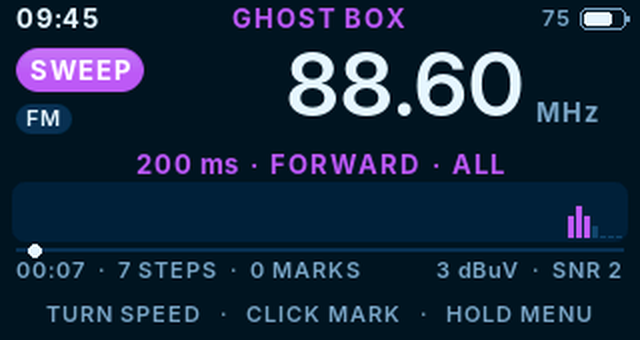 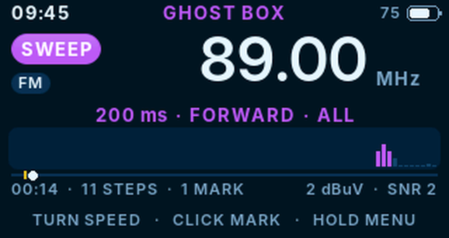

1. Menu > **Apps** > **Ghost Box**. The sweep starts at once: FM 88-108 MHz, 200 ms per frequency, forward.
2. **Turn** to change the speed (30 to 500 ms). **Turn while pressing** for the volume.
3. **Click** the moment you hear something: a **mark** is logged with the time, the frequency and the signal.
4. **Hold** for the menu: *Pause the sweep*, *Mark this moment*, **Question asked** (marks the moment you ask a
   question, so the answers that follow show their delay), **Profiles**, **Blind mode**, *Back to the radio*.

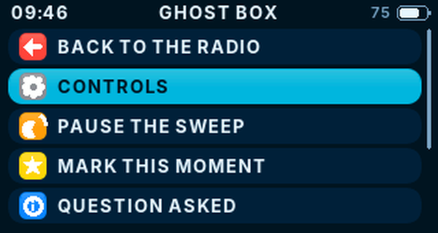 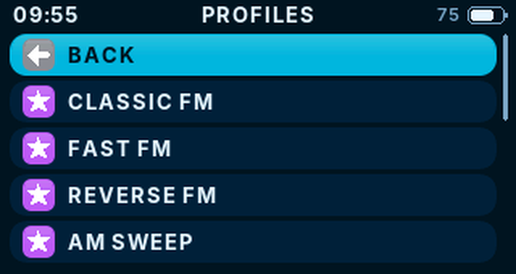

### Pick a profile

Menu > **Profiles** sets everything at once: *Classic FM*, *Fast FM*, *Reverse FM*, *AM sweep*, *Estes session*,
*Hot-spot clusters*, *Noise only*, *Slow AM irregular*, *Shortwave chaos*. You can save three of your own.

### Fine-tune with the controls

Menu > **Controls** opens the strip: **turn** to a control, **click** to change it, turn, click. The line above
explains each one.

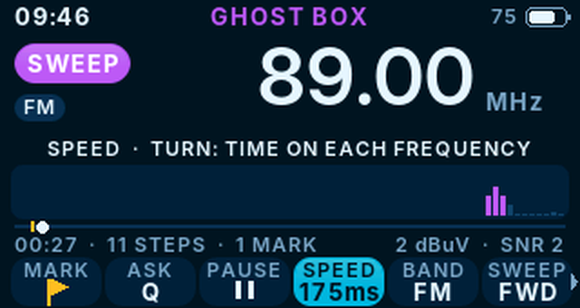 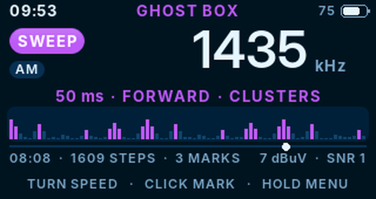

Good starting points:

- **Sweep**: *Shuffle* plays every frequency once per round in a new order; *Dual* alternates two sweeps.
- **Play**: *Noise only* skips stations; *Clusters* plays only around stations (fragments of speech).
- **Catch**: when a frequency carries a real signal, stays there 0.5 to 5 s so a whole word can be heard.
- **Hold**: after a mark, goes back to the frequency you heard and stays there.
- **Wait**: an answer window after each question, with a countdown.
- **Arm**: trigger mode, muted until a burst of radio energy opens the sweep.
- **Timer** and **Blind**: a fixed session length, and a screen that hides frequency and signal (Estes method).

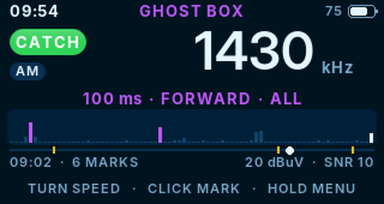 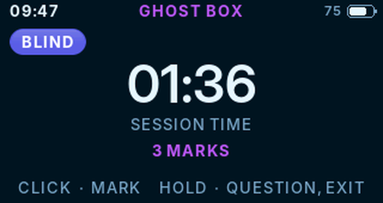

## With the editor: record and review

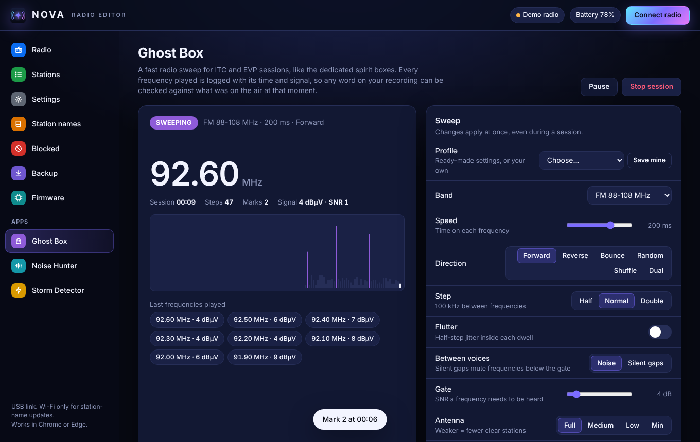

1. Connect the radio to the editor, open **Ghost Box**.
2. Plug the radio's **headphone output** into the computer's line or microphone input (or hold a microphone near the
   speaker). Choose it in *Audio input* and keep **Start and stop with the session** ticked.
3. Pick a profile or set the sweep on the right, then click **Start session**: the radio sweeps and the computer records.
4. Press **Space** when you hear something and **Q** when you ask a question (or the two big buttons).
5. Click **Stop session** at the end.

### Review

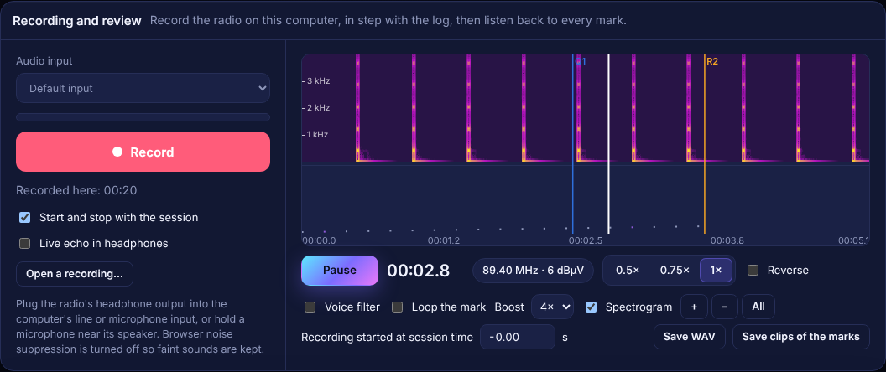

- Click a mark to jump to it. The waveform, or the **Spectrogram** (0-4 kHz, where voices are), shows the frequencies
  played under the sound.
- Listen at **0.5×** or **0.75×**, **Reverse**, with the **Voice filter**, a **Boost**, and **Loop the mark**.
- Type what you heard, word for word, in the marks table. The **Source check** tells you whether the response came from
  a station in your list, a strong or weak carrier, or noise only: a response on a known station is most likely the
  broadcast itself.

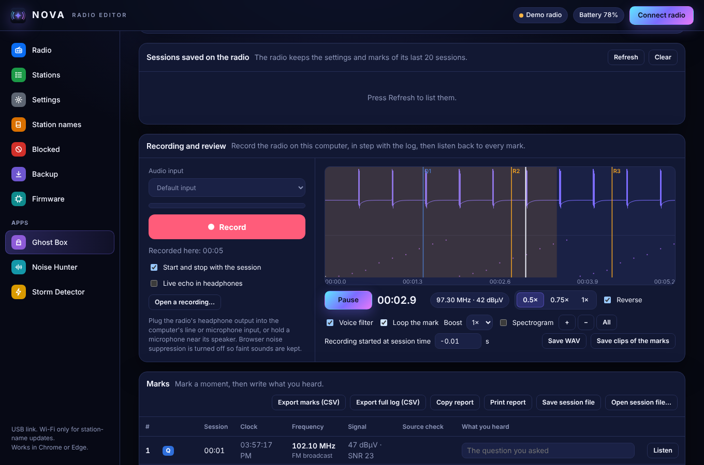

### Keep it

**Save WAV**, **Save clips of the marks**, **Export marks (CSV)**, **Export full log (CSV)**, **Save session file**
(reopen it later with *Open session file*) and **Print report**:

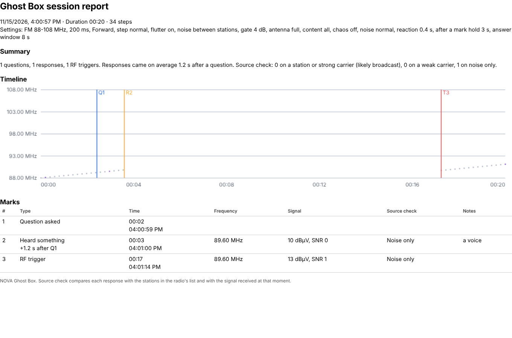

The radio itself keeps the settings and marks of its last 20 sessions (*Sessions saved on the radio*).

Next: [find interference with Noise Hunter](07-noise-hunter.md).
