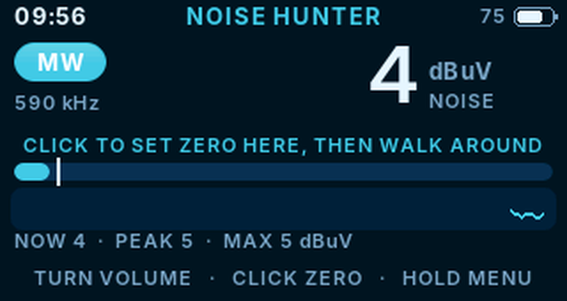
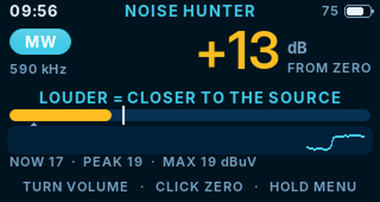
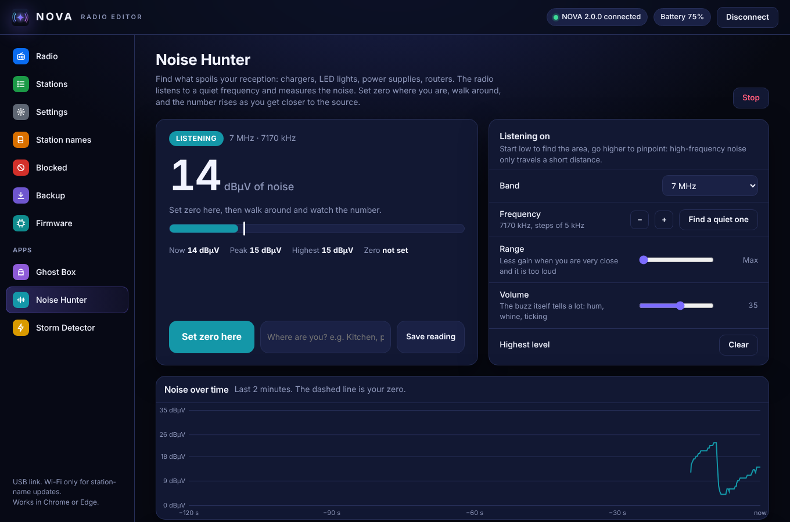

# 7. Find interference with Noise Hunter

Phone chargers, LED bulbs, power supplies, solar inverters and routers spray noise over AM and shortwave. Noise Hunter
turns the radio into a sniffer to find them.

 

1. Menu > **Apps** > **Noise Hunter**. It starts on medium wave, on a quiet frequency (no station), with a fixed gain
   so the number follows the real noise.
2. Stand where reception is good and **click**: this level becomes **zero**.
3. Walk around with the radio. The number shows **dB above your zero**: louder means closer to the source. The bar
   and the small chart follow it. **Turn** for the volume: the buzz itself often tells you what it is (hum, whine, ticking).
4. Hold the radio near suspects. Unplug them one by one and watch the number fall.

**To pinpoint:** start on MW or LW to find the room, then go higher (menu > **Controls** > **Band**: 7, 14, 21 or
28 MHz). High-frequency noise only carries a short distance, so the peak is sharper. If you are very close and the
level is stuck at the top, turn **Range** down.

Menu (hold): **Save this reading** (a spot with its level, numbered), **Find a quiet frequency**,
**Clear the highest level**, **Controls**, **Back to the radio**.

## In the editor

The live level, a two-minute chart with your zero, and a list of readings where you can type the place
("Kitchen, near the fridge"), exported as CSV.

Next: [watch storms](08-storm-detector.md).
