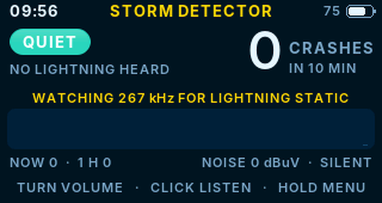
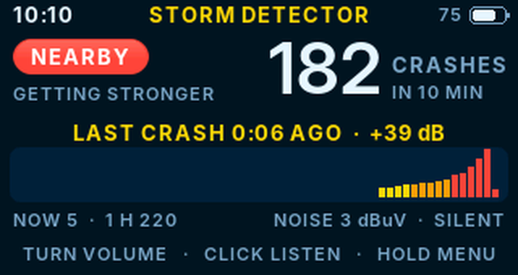
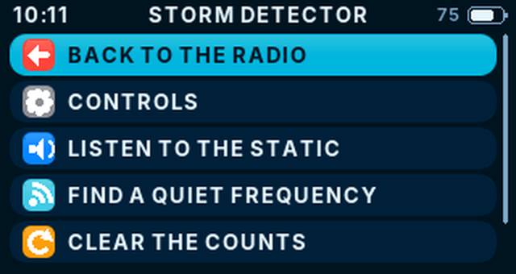
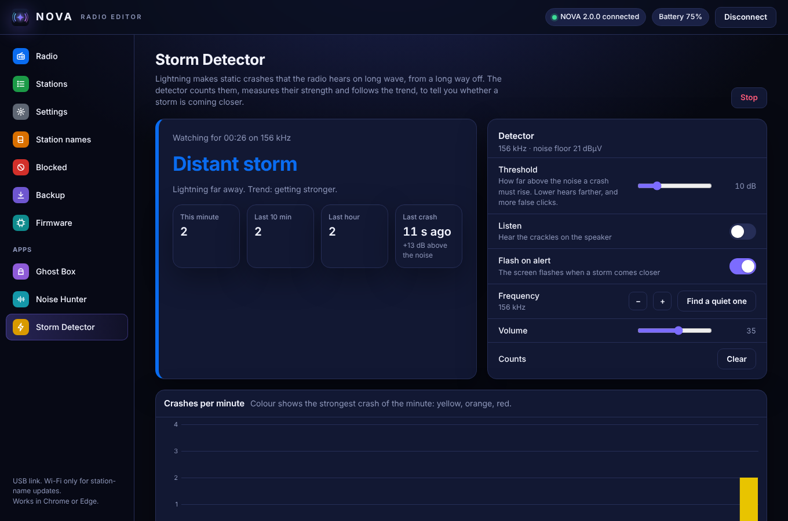

# 8. Watch storms with Storm Detector

Lightning radiates bursts of radio energy ("sferics") that travel hundreds of kilometres on long wave. You hear them
as crackles on an AM radio long before you hear thunder. Storm Detector counts them.

 

1. Menu > **Apps** > **Storm Detector**. The radio finds the quietest long-wave frequency and watches it with a fixed gain.
2. Leave it running. Every short burst above the noise is a **crash**; the screen shows the crashes in the last
   10 minutes, the last crash and its strength, and a chart per minute.
3. The status tells you what is happening: **Quiet**, **Distant storm**, **Approaching**, **Nearby** (or **Noisy** when a device nearby is clicking). "Getting stronger"
   means the crashes get louder: the storm is coming closer.
4. **Click** to hear the crackles (*Listen*), click again for a silent watch. **Turn** for the volume.

Menu (hold): **Controls** (*Thresh* sets how far above the noise a crash must be: lower hears farther, with more
false clicks; *Flash* flashes the screen on alerts), **Find a quiet frequency**, **Clear the counts**, **Back to the radio**.

Electrical noise (a motor, a light switch) can also make crashes: if counts rise with a clear sky, try
*Find a quiet frequency* or raise *Thresh*. Storm Detector is a fun indicator, not a safety device.

## In the editor

The alert level, counts for this minute, 10 minutes and the last hour, crashes per minute coloured by strength, and an
event list you can export.

Next: [make it yours](09-make-it-yours.md).
