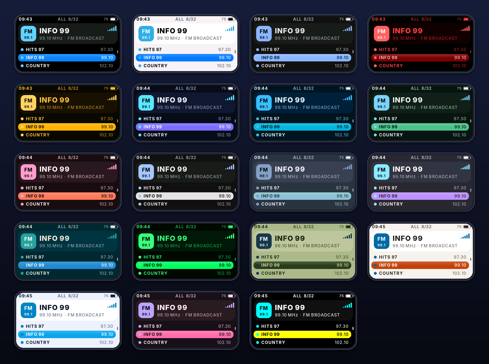
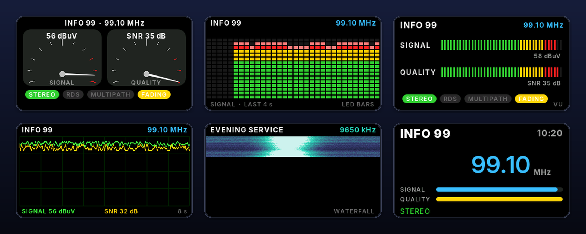

# 9. Make it yours

## Themes

Settings > **Display** > **Theme**: 19 themes, from the deep blue **NOVA** to *Night red* (keeps your night vision),
*Retro LCD*, *Paper*, *Nord*, *Dracula* and *High contrast* for bright sunlight. The change is immediate.

## Display settings

| Setting | |
|---|---|
| Capital letters | the clean all-caps look, or normal letters |
| Brightness, Screen timeout | lower brightness saves battery and reduces screen noise on AM |
| Home screen | start on the station list or on free tuning |
| Reverse knob | if turning right should go down |
| Visualizer when idle | show a visualizer after a while without touching the knob |
| Visualizer: battery saver | slower animation, longer battery |
| Boot animation | the NOVA star at power on (a click skips it) |

## Visualizers

Menu > **Visualizer**. **Turn** for the next style, **click** to show or hide the station, **turn while pressing** for
the volume, **hold** to go back. The radio chip does not pass the sound to the processor, so the visualizers show what
the receiver measures: signal, quality, multipath, stereo and fading.

## Power

**Hold 2 s** anywhere:

- **Standby**: screen off, the radio keeps searching for new stations.
- **Screen**: screen off, the radio keeps playing. A click brings the screen back.
- **Power**: off. A click switches it on again.

Settings > **Power** has a sleep timer and the battery state.

Next: [update, back up, go back](10-update-backup-restore.md).
