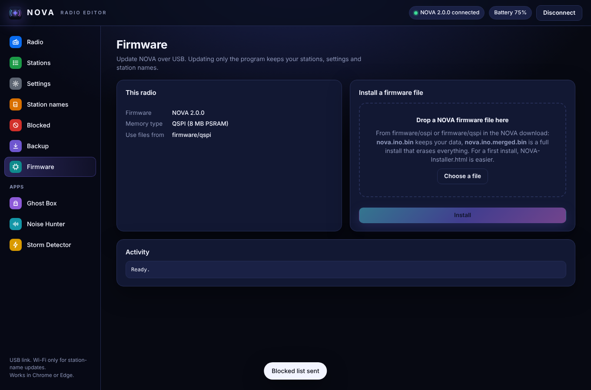

# 10. Update, back up, go back

## Update NOVA

New versions are published on the [releases page](https://github.com/isod89/nova-firmware/releases). Updating keeps
your stations, favorites, settings and station names. Two ways:

- **Installer**: open NOVA Installer, connect. It sees NOVA on the radio and goes straight to **Update NOVA**.
- **Editor**: Firmware page, drop `nova.ino.bin` from the release (`firmware/ospi` or `firmware/qspi`, the page tells you
  which) and click **Install**.

After an update, **switch the radio off and on again**: it does not always restart by itself after a USB install.

## Back up your settings and stations

Editor > **Backup** > **Download backup file**. Keep a copy before experiments; restore it with **Restore everything**
(or only the settings or the stations).

## Go back to the original firmware

NOVA Installer > **Advanced options** > **Restore a backup…**, choose the `.bin` saved in [tutorial 1](01-install.md).
It writes back the whole flash, exactly as it was.

No backup? Any other ATS Mini firmware can be installed over NOVA with its own instructions (look for a
`.merged.bin` file written at address 0x0).

## Start from zero

- **Factory reset**: Settings > About > *Factory reset*, or hold the knob while switching on. Erases settings and stations.
- **Clean install** in the installer, or **Erase the whole flash** (Advanced options) to wipe everything.

Back to the [tutorials](README.md).
