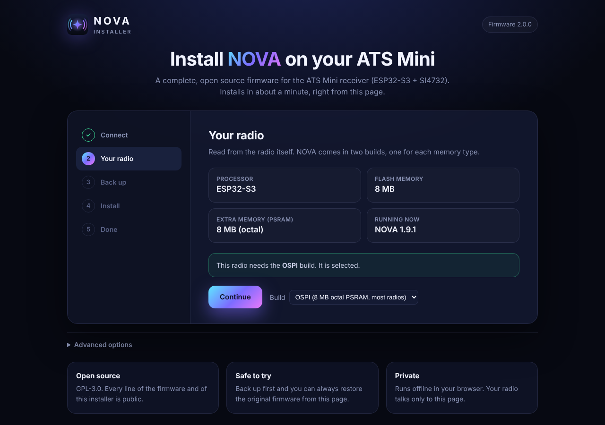
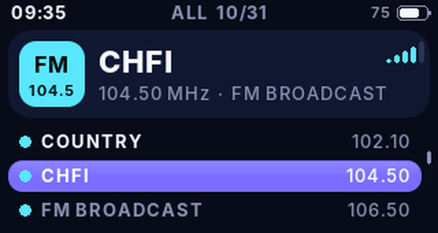
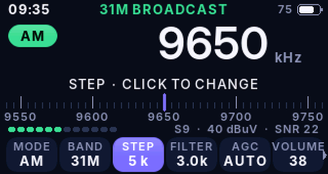
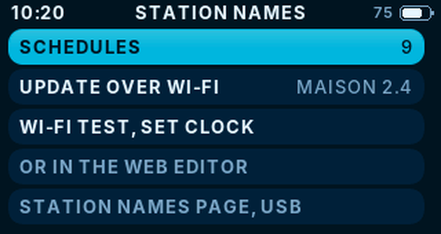
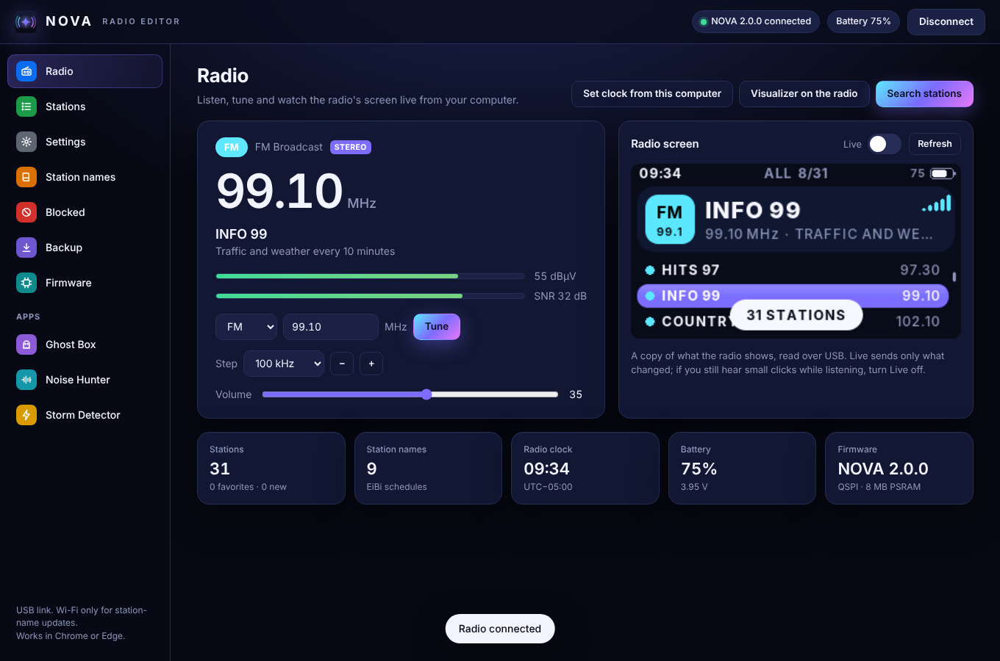
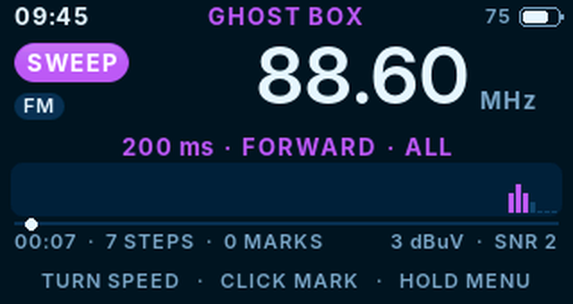
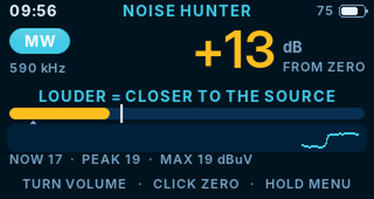
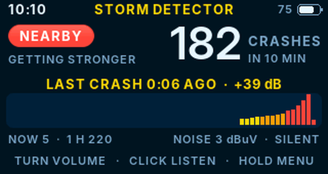
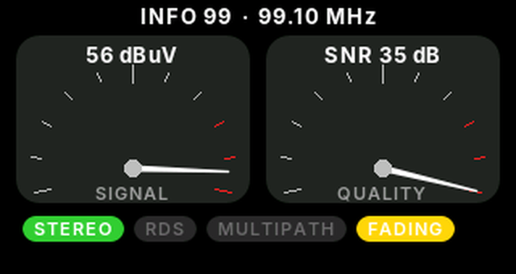
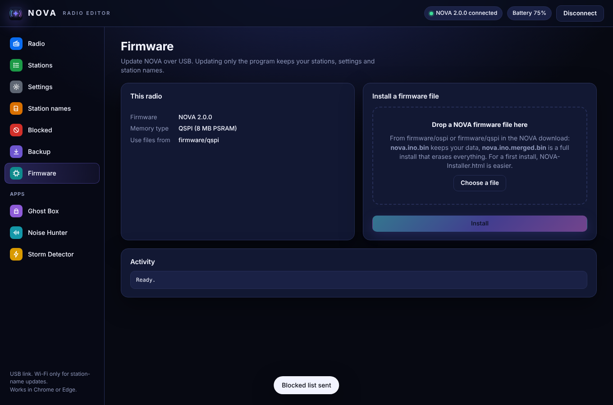

# NOVA tutorials

Step-by-step guides, from the first installation to a full Ghost Box session. Each one takes a few minutes.

| | Tutorial | You will learn |
|:-:|---|---|
|  | [1. Install NOVA](01-install.md) | back up the original firmware and install NOVA from your browser |
|  | [2. Your first stations](02-first-stations.md) | search every band, browse, filter, favorites, blocking noise |
|  | [3. Free tuning, shortwave and SSB](03-free-tuning.md) | bands, steps, filters, the keypad, the spectrum scope, saving |
|  | [4. Station names and the clock](04-station-names.md) | name every shortwave station with EiBi, over Wi-Fi or USB |
|  | [5. The web editor](05-web-editor.md) | stations, settings, backups and the live screen from your computer |
|  | [6. A Ghost Box session](06-ghost-box-session.md) | prepare, sweep, mark, record and review a session |
|  | [7. Find interference with Noise Hunter](07-noise-hunter.md) | track down the charger or LED bulb that spoils your reception |
|  | [8. Watch storms with Storm Detector](08-storm-detector.md) | hear lightning on long wave and follow a storm |
|  | [9. Make it yours](09-make-it-yours.md) | themes, boot animation, visualizers, home screen, power |
|  | [10. Update, back up, go back](10-update-backup-restore.md) | keep NOVA up to date and return to the original firmware |

Want to know what happens inside? Read [How NOVA works](../how-it-works.md).

**The knob, in one line:** **turn** it, **click** it (short press), **hold** it (half a second),
**hold 2 s** for power, or **turn while pressing**. In every app the bottom line of the screen tells you what each gesture does.
