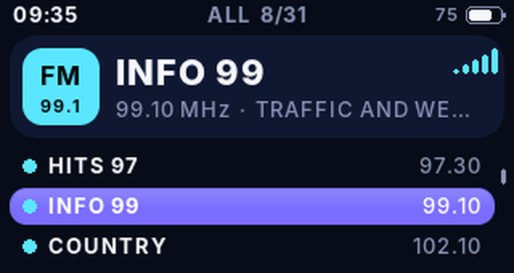
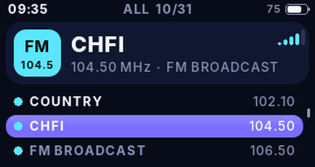
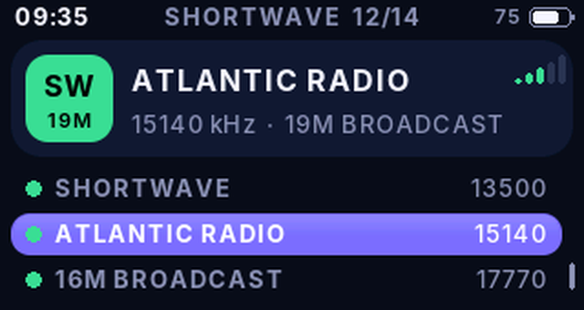
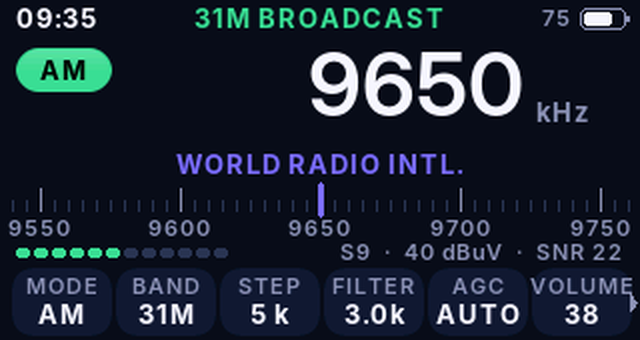
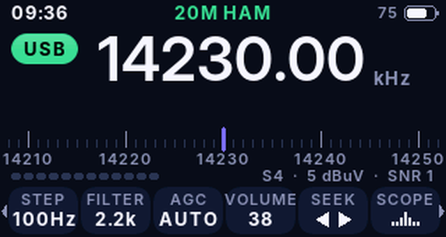
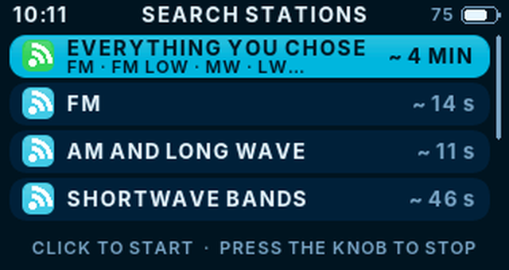
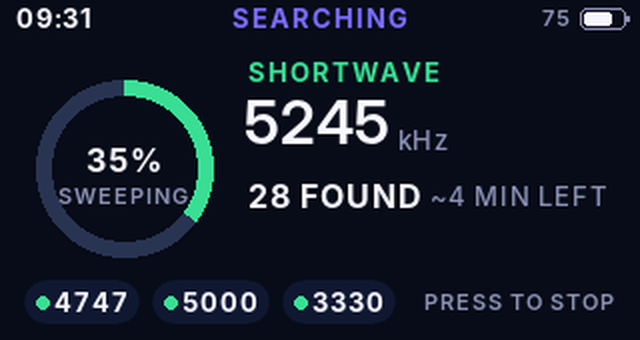
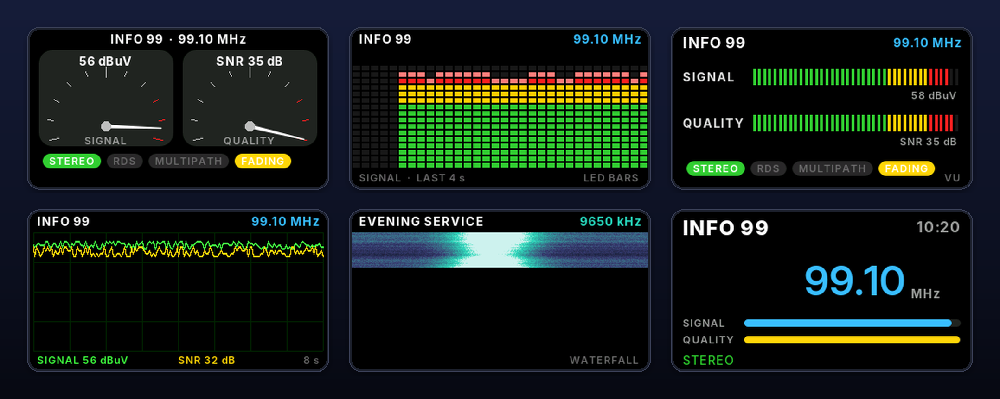

# NOVA user guide

NOVA turns the ATS Mini into a modern world band receiver. Everything is done with the single knob:
**turn** it, **click** it (short press), **hold** it (half a second), or **turn while pressed**.

## First start

After installing, the radio shows the NOVA star while it starts. Your station list is empty:
hold the knob, choose **Search stations**, then **Everything you chose**. A full search of every band takes
about 4 minutes (Normal speed); FM alone takes about 15 seconds. You can stop a search at any time with a click,
the stations found so far are kept.

## Everyday controls

| Where | Turn | Turn while pressed | Click | Hold | Hold 2 s |
|---|---|---|---|---|---|
| Station list | next / previous station | change the filter | volume | menu | power and standby |
| Free tuning | tune, or the selected control | big steps (1 MHz FM, 100 kHz AM, 10 kHz SSB) | open the controls / change | close the controls, then menu | power and standby |
| Menus and settings | move | | choose | back | |
| Apps and visualizers | as shown at the bottom of the screen | volume | as shown | app menu (first line: back to the radio) | |

## Station list

 

- The big card is the station you hear: name (RDS for FM, EiBi schedule for AM and shortwave), frequency, band, and
  live signal bars. FM stations show their RDS text.
- Turn while pressing the knob to change the filter shown on the top line: All, Favorites, New, FM, AM, Shortwave.
- From the menu: add to or remove from **Favorites**, **Fine tune this station**, or **Block** a frequency that is
  only noise (the scanner will never list it again).

## Free tuning

 

Turn to tune. A click opens the control strip at the bottom; turn to pick a control, click to change it:

| Control | What it does |
|---|---|
| Mode | FM, AM, LSB, USB, CW |
| Band | jump to a band (broadcast, amateur, utility) |
| Step | tuning step, from 10 Hz in SSB to 1 MHz |
| Filter | receiver bandwidth |
| AGC | automatic gain, or a fixed attenuation |
| Volume | volume |
| Seek | find the next station up or down |
| Scope | ±250 kHz spectrum around you: turn to move, click to listen |
| Keypad | type a frequency |
| Save | add this frequency to your stations, as a favorite |

## Searching for stations

 

Menu > **Search stations** shows what each search covers and how long it takes. **Speed** has three settings:
Fast (strong stations only), Normal, Thorough (weak stations, takes longer). Settings > Scanner chooses which bands
"Everything you chose" covers, the sensitivity, the off-grid search (finds stations a few kHz off the usual grid),
and whether the radio searches by itself at power on.

**Standby search** (menu, or hold 2 s > Standby) lets the radio keep searching with the screen off and marks what it
finds as **New**.

## Apps

Menu > **Apps**. Hold the knob inside an app for its menu; the first line always goes back to the radio.

- **Ghost Box**: see [ghost-box.md](ghost-box.md).
- **Noise Hunter**: set zero where reception is good, then walk around the house with the radio. The number rises as you
  get closer to the source of interference (chargers, LED bulbs, power supplies, routers). It can also find the
  quietest frequency on a band.
- **Storm Detector**: listens to longwave for the crashes made by lightning, counts them per minute, shows the trend,
  and warns when a storm is getting closer (it can flash the screen).

## Visualizers

Menu > **Visualizer**, or by itself after a while without touching the knob (Settings > Display > Visualizer when idle).
Turn for the next style, turn while pressed for the volume, click to show or hide the station, hold to go back.
The radio chip does not send the sound to the processor, so the visualizers show what the receiver measures: signal,
quality, multipath, stereo and fading.

## Settings

| Page | Settings |
|---|---|
| Scanner | speed, sensitivity, bands to search, time for a search, off-grid search, search at power on, standby pause, search now, unblock all, clear the list |
| Audio | volume, squelch, AM soft mute, AM maximum gain, FM stereo (smart blend), click suppression |
| Reception | region (FM de-emphasis and MW grid), RDS, LW/MW antenna tuning, AM / FM / SSB filters, AM and FM gain control, SSB calibration |
| Display | theme (19), capital letters, brightness, screen timeout, home screen, reverse knob, visualizer when idle, visualizer battery saver, boot animation |
| Clock | hour, minute, time zone, 12/24 h, set from FM (RDS) |
| Power | sleep timer, battery |
| Station names | EiBi schedules loaded, update over Wi-Fi, Wi-Fi test and clock |
| About | firmware, stations, memory, battery, license, factory reset |

**Factory reset** erases settings and stations. Holding the knob while switching on does the same.

## Power

Hold 2 s anywhere: **Cancel**, **Standby** (screen off, standby search), **Screen** (screen off, radio plays), **Power** (off).
A click wakes the screen; a click also switches the radio back on.

## Station names (EiBi)

AM and shortwave stations get their names from the EiBi world schedule: the radio shows who is on the air at the
current time. Update it twice a year (end of March and end of October), over Wi-Fi (Settings > Station names, network
saved from the editor) or from the editor's Station names page. The clock must be set: from FM RDS, from Wi-Fi, or from
the editor.
